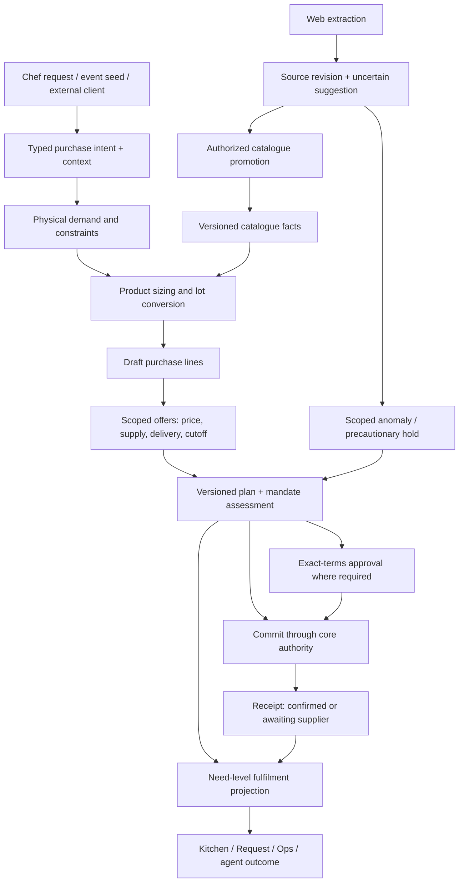

# Round 5: preserve meaning across the whole purchasing workflow

14 November 2026. Outside review of `dc0f213` through `f2edb21`, with later changes through `8400c14` checked for overlapping application edits; the lead was merging concurrently. This is an executor handoff, not an edit to the lead-owned roadmap. Findings include source traces and isolated pure/PGlite reproductions; no live provider, shared Postgres or deployed-browser certification.

Detailed reviews: [domain and persistence](ROUND5-DOMAIN-AND-PERSISTENCE.md), [agent context and APIs](ROUND5-CONTEXT-AND-API.md), [surfaces and read models](ROUND5-SURFACES-AND-READMODELS.md), [web ingestion and provenance](ROUND5-WEB-AND-PROVENANCE.md).

## Judgment

Keep the larger product shape: client purchasing UI, bounded agent, external-agent API and internal Operations. The strongest next work is to make those surfaces preserve the same business meaning. A “4 kg” request must remain 4 kg through parsing, product selection, substitution, approval, receipts and Ops. “Committed” must retain its supplier uncertainty. A plan link must retrieve that exact plan. A source finding must belong to the correct workspace and retain its evidence.

The repo's pure-core/ports architecture can support this. It does not need microservices or a generic platform rewrite. It needs a few shared semantic boundaries and adversarial tests of transitions, especially where two individually reasonable modules currently disagree.

Earlier fixes are real: explicit Kitchen commands, independent offline mode, read-time line views, bounded agent intent/tool context, isolated ordinary tests, separate public workspaces, audited reset and more substantive substitute handling. Do not reopen these as if absent. The new standing-order baseline at `a7600f2` also changes ordinary mandate eligibility; the detailed domain report checks overlap rather than assuming the old behavior.

## Highest-priority executor handoff

These are proposed lanes for the lead to assign, not new instructions issued to the running implementation agents.

| Priority | Problem and observed consequence | Owner boundary | Acceptance evidence |
|---|---|---|---|
| P1 | Request and routine-agent interpretation diverge. A reproduced routine request for 4 kg butter tomorrow became four 500 g sales units on a different date. Request parsing can also accept a model dropping “lactose-free.” | Request + agent + pure demand contract | Same input through both entry points preserves quantity dimension, delivery and explicit constraints; uncertainty asks a question before placement. |
| P1 | Direct-order substitution copies sales quantity across products. One 1 L carton can become one 0.5 L carton. | Core demand/sizing + substitutes | Replacement preserves physical demand; its own pack content, yield and lot determine sales quantity. Unsupported conversion blocks rather than guesses. |
| P1 | Offer cutoff is displayed but does not stop commit; a reproduced expired-offer commit succeeded. | Core offers/commit | Scenario clock after cutoff returns a typed expiry/requote action with no new receipt; before cutoff still succeeds. Approval freshness and offer validity are separate checks. |
| P1 | Zero demand can round to a positive purchase; consumed stock can remain advertised as committable until commit refuses it. | Core sizing + quote/cache reconciliation | Zero remains zero or is rejected; a second plan cannot advertise already-consumed local stock as confirmed available supply. |
| P1 | Unknown supplier supply and incomplete make-in-house lines can become “fulfilled”/“covered”; sales units also appear as kg and €/kg. | Shared fulfilment projection + Kitchen/Ops/agent | Terminal commitment stays awaiting supplier; missing ingredient limits dish coverage; pack counts and prices have explicit bases. |
| P1 | Web routes authenticate a caller then use default workspace ports; findings are global. | Web + auth/store | Judge and presenter cannot read/write each other's finding applications or incidents. Webhook targets are explicit. |
| P1 | Ops links and Request reload cannot recover the exact durable direct-order task. | Plan route/read API + Request + Ops | Event, milk request and external-agent plan can each be opened by scoped identity, reloaded and reviewed to the same receipt. |
| P1 | Event replay is capped at one 1,000-event page before declaring live; rejected projection updates can still advance the cursor. | Event API + Ops reducer | Reconnect beyond 1,000 events equals authoritative state; failed application triggers recovery and does not hide missing state. |
| P1/P2 | A known recall URL is never re-read/applied again; drills share its identity. | Web source/revision/application model | Changed notice, new run, another workspace and drill→real delivery remain distinct and idempotent. |

P1 denotes a correctness boundary to address before demonstrating or claiming the affected guarantee. It does not mean every item must block every unrelated feature. Recheck each fix on current main before parallel implementation.

## Trace the entities and transformations

| Entity / transition | Current implementation boundary | Meaning to retain / repair |
|---|---|---|
| Caller → execution context | Auth, tool gate, agent principal, Request context; web has separate plumbing | Workspace, run, actor, authorized kitchen, scenario clock, source mode and deadline. A UI-selected ID cannot create authority. |
| Text → intent | Request parser versus routine-agent intent resolver | Raw text, parsed quantity + dimension, relative-date resolution, dietary constraints, unresolved questions and interpretation provenance. Preserve explicit user constraints independently of model agreement. |
| Intent/event → need | Event demand model versus direct `place_order` sales lines | Direct orders need durable physical demand too. A plan with no need semantics cannot prove a different pack satisfies the request. |
| Need → sales line | Event sizing, Request conversion, core `toLot`, make-in-house sizing | Desired physical amount, net content per sales unit, yield, lot rounding, excess and uncertainty. One canonical conversion result should feed shortlist and placement. |
| Product → offer | Catalogue plus supplier quote/cache | Product identity is not account-specific price/stock. Retain offer context and observation/expiry times; invalidate or reconcile affected local stock projections after commitment. |
| Offer → plan assessment | Pure mandate tiering and quote ops | Plan version and exact terms; separate insufficient evidence, insufficient stock, hard limit and approval-required reasons. |
| Plan → approval → commit | Orders service/store transaction and supplier port | Approval grants only exact terms. Commit must also enforce current run, offer cutoff, stock and idempotency. Approval cannot turn an expired offer into a valid one. |
| Commit → receipt | Supplier adapter + op persistence | “Awaiting supplier” is a legitimate result, distinct from confirmed physical coverage. Retry returns the same logical receipt. |
| Ops → read views | Core `Line.view`, Kitchen mapping, Request state, Ops reducers, agent outcome | Share need-level quantities/statuses; presentation can differ, business facts cannot. Include projection completeness and staleness. |
| Web → suggestion/incident | Exa grounding, Context.dev extraction, findings, enrichment/anomaly ops | Source identity, revision, retrieval/cache age, evidence confidence, scope, live/replay/drill origin and authorized promotion state. |

## Context management: make the layers explicit

“Put more in the prompt” cannot repair lost units, stale facts or wrong-workspace ports. Organize context into four boundaries:

1. **Authority context:** server-derived principal, workspace/run, kitchen access, allowed actions, deadline and cancellation. Enforce it before every dispatch; never ask the model to police it.
2. **Task context:** typed intent, physical needs, hard constraints, resolved delivery, pending questions and selected plan identity. Persist the parts needed to resume the user's task after reload.
3. **Evidence context:** bounded facts with quantity bases, source/observation time, uncertainty and provenance. Current agent trimming is useful, but silently hiding line 41 can hide a shortage. Return counts, completeness, omitted exceptions and a way to inspect more.
4. **Presentation context:** current plan/version, applied versus proposed selection, available actions, projection cursor and stale reason. It must not infer authority or confirmed coverage from a label such as `committed`.

Use hierarchical tool scoping only where it improves the task: coarse workflow capability at admission, kitchen/resource checks at dispatch, state-specific valid actions from the core, bounded arguments, then deterministic outcome verification. Tool-description filtering alone is not authorization. Richer context should make decisions more informed without widening the principal's grants.

## Coherence and maintainability improvements

**Consolidate duplicated meaning, not every similar-looking helper.** A common `PurchaseIntent` and `SizingResult` address real discrepancies between Request, routine orders and event rescue. A common `FulfilmentView` addresses false coverage claims across three surfaces. A `WebExecutionContext` addresses lost authority. Keep the ports and module layout until these contracts prove a different organization necessary.

**Separate commands, durable facts and projections.** Commands carry intent and idempotency; persisted ops record accepted facts; read models calculate current allowed actions and coverage. Browser projections need a completeness/version contract and a resync path. Findings should not form another unsynchronized mutable truth in a process-global map and JSON file.

**Model lifecycle transitions rather than adding booleans.** Offer `observed → valid → expired`, source `retrieved → validated → suggested → reviewed/promoted`, supply `planned → committed-known | awaiting-supplier → confirmed/failed`, and projection `catching-up → complete | stale`. These states need clear guards and recovery actions, not necessarily new frameworks.

**Make API boundaries validate semantics.** Validate provider and route payloads at runtime; reject unsupported dimensions; preserve explicit constraints; attach evidence and source mode. A typed cast over JSON is not validation. HTTP 200 is not successful extraction. A receipt is not necessarily confirmed supply. A successful model response is not a fulfilled user goal.

## Roadmap: a clean larger scope, with quality gates

| Phase | Coherent outcome | Gate before extending it |
|---|---|---|
| 1. Trusted purchasing foundation | Chef, outside agent and Ops operate the same scoped plan through a correct quantity/offer/approval/receipt chain | Cross-entry-point intent fidelity, exact plan recovery, expiry checks, truthful coverage and scoped ingestion. |
| 2. Complete evidence-assisted workflow | One recall or enrichment goes from source to evidence view to affected plan to human resolution | Revision-aware ingestion, durable job recovery, evidence retained, uncertainty visible, no silent safety-fact promotion. |
| 3. Nationwide discovery and simulation first | Discover/identify Finnish venues, show evidence/readiness, estimate a kitchen's needs without implying purchasing access | Venue deduplication, source freshness, estimate confidence, explicit simulation mode, no buyer-account authority inferred from a website. |
| 4. Connected kitchens and purchasing | Organization/site/buyer-account connections enable real scoped offers and ordering | Supplier agreement and account mapping, menu/recipe/yield inputs, hard constraints, permissions, timezone/cutoff and per-site readiness. |
| 5. Broader automation and enrichment | More providers/jobs improve measured data completeness or task quality | Each addition changes an observable user outcome and has fixtures, provenance, failure behavior and an evaluation set. |

This preserves the user's preferred expansion order. Exa can discover suppliers/venues and candidate evidence; Context.dev can extract/monitor selected sources; a later multimodal model can propose menu/document structure. None independently establishes recipe quantities, stock, allergen safety or ordering authority. Evaluate extraction against labelled examples before calling it a purchasing capability. The internal dashboard is valuable as the human workbench for uncertain evidence, holds and failed jobs—not merely a second visualization of successes.

## Verification and limits

The ordinary server suite at the initial review snapshot passed **248 tests, with 7 intentionally skipped** across 45 passing / 3 skipped files. The rerun after `a7600f2` passed **252 tests, with 7 skipped**, across 46 passing / 3 skipped files. These passes do not cover the newly reproduced gaps above. Live Gemini and opt-in real-Postgres tests were not run. Isolated reviewer probes used fake provider responses, pure production functions and fresh PGlite; detailed reports distinguish each.

No deployed browser, mobile accessibility, paid-provider behavior, real supplier account, production concurrency or live monitor delivery was certified here. Review documentation was added; application fixes remain with the lead/executors.

The separate [lead checkpoint](../handoff/review-lead.md) reports its own live Gemini, Aiven and deployed-flow evidence. Those are useful complementary checks, not tests performed by this reviewer, and they do not exercise all the semantic counterexamples above.
