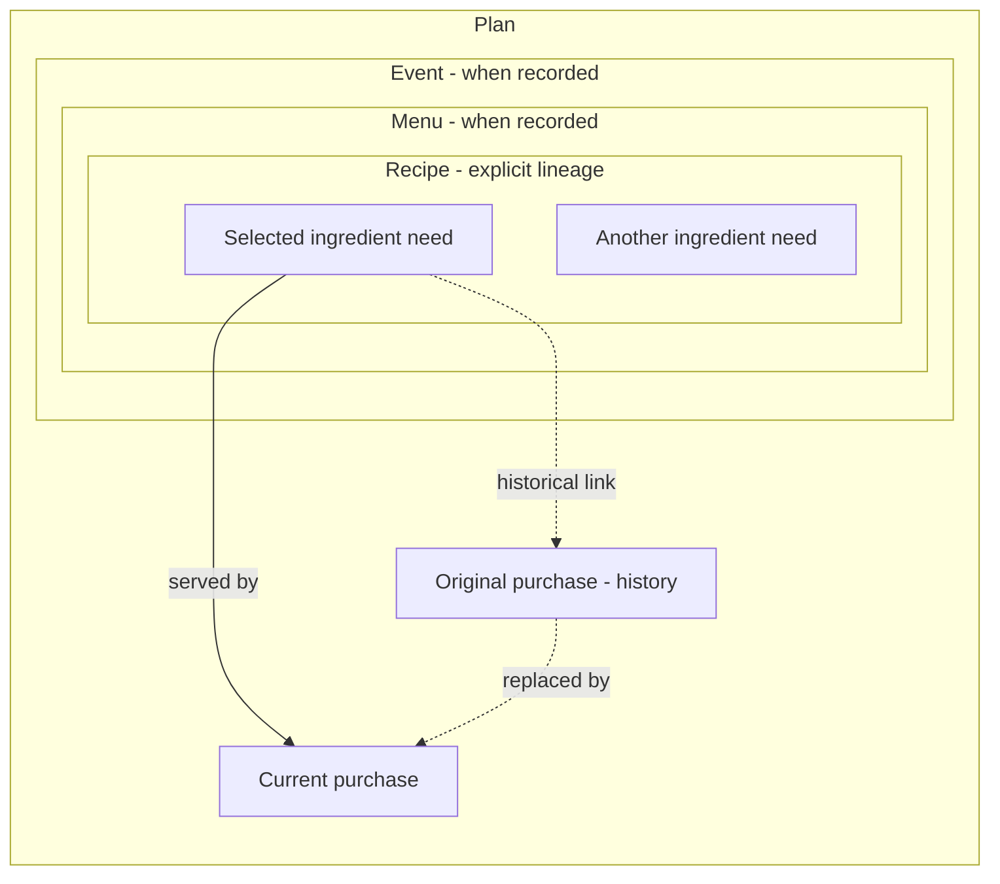

# D3 basket canvas: proposed next slice

**Design proposal; the graph renderer is not implemented.** Mode: Operate. Extend `/canvas` within [Mandate's design system](../design/DESIGN.md). Author the layout and interactions afresh; copy no reference implementation or assets.

## Recommendation and decision point

**Recommendation: finish the card view now, then build the graph only as a complete agent-view slice.** A card layout alone does not satisfy the original agent-steered canvas goal. The next slice must include typed selected-entity context and a working agent-to-view response, with an assigned chat/contracts owner.

The graph earns its place when a shortage affects several recipes, one catalogue product serves several distinct ingredient needs, or the chef needs to follow why a replacement resolves a gap. A flat basket, checkout and phone scanning remain better served by the cards. Keep the graph optional and compare one concrete journey: select a shortage, identify affected recipes, inspect a replacement, and see the resulting decision. Build it if relationships plus agent reveal reduce the work of that journey; a different arrangement of the same cards alone is insufficient.

[CLAUDE.md](../../CLAUDE.md) and [PLAN.md](../PLAN.md) record Sunday 15 November **06:00 feature freeze** and **10:00 submission**. [Ring 6's restart notes](../handoff/ring6/RESTART.md) queue a change to the freeze framing; that queued item does not establish a new deadline. Use the lead's current integration budget, not the older STATUS checkpoint, to decide. Protect time for the existing purchasing path, visual checks, gate, recording and submission. If the minimum slice below cannot fit with those checks, defer it and keep this as the next-build brief.

## Visual direction

Desktop: a plan frame contains nested event, menu and recipe groups **only where recorded lineage supports them**, with an ingredient-need node inside each recipe. Direct orders use an Ingredients group. A breadcrumb and Fit control anchor the scene; search and diet/state lenses sit above it; the existing agent dock remains alongside it. Use a deterministic left-to-right layout with stable positions, not a force simulation.

At overview, show recipe names, need names, demand and one readable state. Selecting a need opens its purchase branch to the right: actual current purchases, split purchases, retained original history and the recorded replacement relationship. Put detailed product cards, alternatives and exact-terms decisions in the inspector. Keep unrelated purchase branches folded. The plan's quoted total is authoritative; graph containers never invent totals by summing repeated references.

Illustrative topology only; these labels are not fixture records, prices or claims of existing functionality:

D3 should handle bounded pan/zoom and layout geometry; Svelte and the shared cards should render accessible content and actions. Dataset objects stay immutable and graph joins use IDs. No free positioning or graph persistence is needed for this slice.

The first scene should use padded recipe outlines and compact ingredient rectangles, with a 32 px purchase thumbnail only at detail scale. At overview, each node shows its name and one state; at inspection scale it adds demand and diet marks. Keep the selected need anchored when its purchase branch opens. Draw only the selected branch's links, using words such as "served by" and "replaces" alongside line style; do not draw every possible alternative across the scene. Node area accommodates readable content, not mixed kg/l/price magnitudes.

Implementation shape: a layout module computes IDs, coordinates and group bounds outside the pure business core. Svelte renders positioned HTML node controls and an SVG edge layer using the same camera transform; the existing inspector owns detailed interactions. A single view store controls selection, reveal, lens and camera for both graph and card renderers. The domain projection and purchasing handlers remain shared. Layout measurement may be cached, but a selection change must not repack the scene.

## Interaction semantics

| Control | Proposed behavior |
|---|---|
| Zoom / pan | Navigate the scene without changing quantities, selection or approvals. Provide visible zoom buttons and keyboard equivalents; wheel/touch navigation must not trap normal page scrolling. Respect reduced motion. |
| Select | Select exactly one domain entity; retain its identity through quote/product changes. Need selection reveals its purchase branch and inspector. Escape closes details and returns focus to its node. |
| Focus / reveal | Reveal ancestors and bring a named entity into view. Report a filtered target and offer Clear lens; do not silently erase the chef's lens. A reveal may show an explicit selected-item exception. |
| Fit | Fit the current visible scene. Fit selection frames the selected need and its branch. Refreshes preserve the camera; only an explicit command or a new plan resets it. |
| Collapse | Fold descendants while retaining group counts/state and the selection reference. A selected descendant remains named in the inspector and breadcrumb. Collapse never removes domain records. |
| Search | Match need and product names, show result count and ancestor context. Choosing a result reveals its branch; Clear restores the prior overview without a domain write. |
| Diet lens | Filter/highlight declared product claims separately from desired need requirements. Unknown stays unknown. A recipe is not labelled compliant merely because one visible ingredient matches. |

Use the same product card, thumbnail, comparison rows and DecisionCard in the inspector, Kitchen and chat. The graph node is a compact entry to those components. At 390 px, default to the existing nested outline with an ingredient/details switch, full text and a reachable first decision; do not shrink a desktop graph into unreadable cards. Both views use the same projection, selection and agent intents. Keyboard users can complete the same journey through the outline.

## Product imagery

Use the current cached photo lookup for both renderers, with fixed slots and explicit exact/approximate/brand/no-photo states. At overview, use the entity icon; at ingredient detail, show the current purchase's photo; in the inspector, show the larger packshot. A flour pack is a purchase image, never a picture of the finished recipe. Loading or broken images keep the same slot and a readable fallback. Inspecting product facts remains a deliberate action.

Cloudinary is an optional media adapter, not part of D3 layout or agent authority. A later integration could import verified source photos and cache an `e_background_removal` derivative while retaining the original, match/provenance and a pending/error fallback. Prepare these per asset with a transformation budget, outside rendering and chat turns. The current tracked app has no active Cloudinary adapter; account configuration and source ingestion are separate work. [Cloudinary background removal](https://cloudinary.com/documentation/background_removal).

## Agent and domain boundary

- Send a typed context envelope with the chat turn: workspace/run/plan/version, entity kind and domain ID, selected need/line/candidate references where relevant, and a browser selection revision. Resolve authoritative facts server-side. A label in a draft is insufficient when two recipes need the same ingredient.
- Identify scene entities by `(workspaceId, runId, planId, entityKind, domainId)`. Need identity is distinct from catalogue product identity; one product can serve several needs. Group IDs derive from recorded lineage, not labels or array indexes. Local edges use scoped endpoints.
- Add a small validated presentation intent union: focus/reveal entity, expand/collapse group, set/clear a supported lens, fit scene/selection. Address the current view session and originating turn. Reject another plan/run, missing entities and stale selection revisions; a chef's newer selection wins over a late agent response. Return applied/ignored plus reason, so narration reflects what the view actually did.
- Presentation intents change browser view state only. Purchasing changes still use the existing scoped/versioned tools, transactional `applyOps` path and exact-terms human approval. The model receives no raw pixel coordinates, arbitrary CSS, freeform image URLs or authority to recolor safety states. The renderer owns layout, semantic color, icons, size presets and verified product imagery.
- First implement this round trip in the in-app dock. External MCP/REST presentation control would need an explicit paired browser session and a presentation permission; underlying plan access alone must not steer every viewer in that workspace.

**Needs:** the lead/chat/contracts owner must own the context envelope and presentation channel. The core/UI owners must resolve the ongoing selected-product swap-sizing seam before arbitrary candidate picks are reused: main's current product-only `edit_line` pick preserves the old sales quantity. This proposal does not solve that seam. Keep the existing server-sized recommendation path meanwhile.

## Minimum GO scope and proof

Build one existing-plan nested scene, stable need nodes, focus-only purchase/replacement branches, bounded zoom/fit, collapse, search/diet lenses and the mobile outline. Include the typed context/presentation round trip: the chef selects one of two similarly named needs, asks about it, and the agent reveals that exact need/branch or applies a named lens. Exclude arbitrary nodes/edges, recipe authoring, cross-plan graphs, persisted layouts, drag editing, 3D and model-generated styling.

Acceptance requires: (1) that exact-identity agent journey works with fixture tools; (2) a business edit still uses the existing gate and refreshes the selected branch; (3) reset, missing entity and late-agent/manual-selection races produce an explicit ignored result; (4) graph and outline agree on split, unresolved and retired lines without double-counting; (5) desktop/390 px screenshots, keyboard/reduced-motion checks and 10x fixture data remain usable; and (6) targeted checks plus the lead's integration gate pass. Until then, describe the graph as proposed.

The main risks are shared chat-contract work, graph density, camera movement interrupting inspection, and confusing an ingredient need with a product or fulfillment strategy. If any of these blocks the full agent-view proof, stop the optional graph slice rather than shipping another card arrangement under the agent-steered claim.
