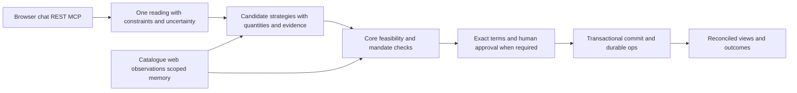

# Repository correctness and architecture review

Review begun on runtime code at `804b8927`, 15 November 2026, with concurrent changes reconciled through `6e5260d3`. The full baseline gate and browser build belong to `804b8927`; they do not certify the later merged runtime. D33/D34 priorities are reflected below. Covers purchasing, request/menu/chat/agent entry points, storage and live updates, external services, deployment, tests, and strategies for unfamiliar inputs. Runtime code is unchanged by this review. Reproductions and logs are in the ignored `scratch/repo-review/` directory.

The purchasing core has useful boundaries: deterministic requirements and quantities, approval bound to terms, transactional stock and budget accounting, idempotency, and a shared tool registry. Keep these. The most urgent gaps are around **what becomes trusted memory, what counts as fresh evidence, and what is actually shared across processes**. These can undermine a correct core by giving it an incorrect or incomplete picture.

The existing stack is sufficient for the next stage. The best gains come from completing its contracts and making fewer, better targeted calls. Additional providers or a distributed framework would add work before these gaps are resolved.

## Findings by priority

P1 means incorrect domain behavior or a material reliability/security boundary. P2 means an important robustness, performance, or reproducibility issue. “Reproduced” distinguishes executable probes from code-traced failure sequences.

| ID | Priority | Finding | Evidence |
|---|---|---|---|
| G1 | P1 | An unreviewed model pick becomes reusable ingredient memory and bypasses the new menu's resolver and chooser. Plant diets are omitted from pin validation. | Reproduced: a prior chicken pick appears in a vegan menu, zero resolver calls, no blocking rubric issue. |
| G2 | P1 | Process-local web snapshots can lose newly queued recall work and hide another instance's findings. | Reproduced with two Node processes using the real queue/persistence code and a fake shared row store: one cached item, zero durable queue rows; one durable finding, zero visible to the other worker. |
| G3 | P1 | A forced-fresh recall read can return stale cache data as a successful read. | Reproduced at the adapter boundary; queue completion after that read is code-traced. |
| G4 | P2, addressed during review | The baseline could permanently miss the last committed event until another event or reconnect. | Concurrent commit `39bb59dc` adds same-run reconciliation about every 6 seconds; failure-injection verification remains. |
| G5 | P2, fixed during review | The baseline retained a first ports-initialization failure forever. | Concurrent code uses a retryable singleton; an isolated probe now succeeds on the second build attempt. |
| G6 | P1 before router activation | The router changes an untrusted Origin into the upstream's trusted Origin. | Reproduced with mocked forwarding. The checked-in router manifest targets workers.dev; this is conditional on using this router. |
| G7 | P2 | Provider retries are omitted from request caps and individual-attempt telemetry. | Reproduced: two HTTP attempts, one guard charge. |
| G8 | P2 | The fixture guarantee depends on unpublished local data. | Confirmed in loader, Docker context, and README; already identified in the earlier independent review. |
| G9 | P2 | Canvas photo state can return to loading after the test has already observed a ready photo. | Reproduced in the full browser pass and the isolated rerun; the isolated run fails at both 1440 and 390 px. |

### G1 Revalidate every remembered choice

[`menu/resolve.ts:78`](../../src/lib/server/menu/resolve.ts#L78) reads model pins from recent proposals without requiring a chef-reviewed proposal. Its key is the ingredient's normalized query/label, with no dish technique, product form, or dietary context. [`menu/proposal.ts:624`](../../src/lib/server/menu/proposal.ts#L624) then tries the pin before resolution. `usablePin` at line 104 checks existence and the lactose/gluten flags; it never receives `plant`, although the normal resolver does. A successful pin skips both resolution and the dish-aware chooser.

The probe stores an unreviewed model choice for chicken and requests a new vegan chicken bowl. The result keeps chicken and claims vegan compatibility, with no blocking review issue. This establishes an incorrect proposal; it does **not** establish that the final core gate would authorize buying meat against a vegan requirement. The same bypass also skips culinary checks for raw/cooked, fresh/dried, and cut/form changes that the core's diet checks cannot settle.

**Fix:** treat prior model choices as retrieval hints. Validate every pin against the current full requirements and ingredient role, regardless of its source. A person's persistent preference should have explicit scope; an unreviewed model choice should not become one. Let incompatible memory fall back to candidates or a clarification. Explicit product hints and `editMenu` pins need the same validator.

**Acceptance:** a remembered product must be reconsidered when diet, dish technique, required form, supply, or catalogue facts change. Test an unreviewed previous proposal, a chef pin, a model pin, and a caller hint separately.

### G2 Use shared rows as the authority for shared work

[`web/index.ts:76`](../../src/lib/server/web/index.ts#L76) hydrates findings, applications, and queue maps once. Reads continue to use these maps. [`web/queue.ts:35`](../../src/lib/server/web/queue.ts#L35) adds work only if its local map lacks the ID. [`web/persist.ts:95`](../../src/lib/server/web/persist.ts#L95) suppresses an upsert when the local value equals that process's saved baseline.

Failure sequence: both workers load a queued `list`; A completes and deletes it; B receives a later change. B still has `list`, so `add` changes nothing, and its flush writes nothing. The database has no job to claim. `FOR UPDATE SKIP LOCKED` correctly coordinates existing rows, but cannot recover an insertion that never happened. Findings written by A also stay invisible to B's already-loaded map.

**Fix:** enqueue with a database upsert independent of local cache membership. Include a change generation/revision so a notification arriving while a job is leased cannot be erased by an older completion. Complete/fail with the lease owner and claimed generation. Read findings/applications from shared rows, or use revisioned invalidation plus bounded reconciliation. Retain local maps as caches.

**Acceptance:** two workers enqueue, claim, finish, re-enqueue, and observe findings in different orders; restart either worker; deliver a new change during a lease. Each acknowledged generation must remain durable until processed. The reproduction uses a fake row sink, so real Postgres lease/concurrency checks remain a separate test.

### G3 Preserve freshness through the adapter boundary

[`external/call.ts:178`](../../src/lib/server/external/call.ts#L178) intentionally serves stale cache entries while a breaker is open, and also after a 429. [`web/http.ts`](../../src/lib/server/web/http.ts) carries `stale`, but [`web/contextdev.ts:51`](../../src/lib/server/web/contextdev.ts#L51) discards it. `readList({maxAgeMs: 0})` can therefore succeed with an old list. [`web/watch.ts:179`](../../src/lib/server/web/watch.ts#L179) calls `queue.done('list')` after a successful read. An edited notice can similarly be treated as freshly checked. Exa's `Structured` shape also drops the stale flag.

**Fix:** carry `fetchedAt`, `stale`, source revision and freshness requirements in the result contract. A stale answer may help a person inspect previous evidence, but must not complete a job requesting a fresh observation. Keep that job pending with a retry time. Preserve freshness in the UI and traces.

**Acceptance:** prime an old list, trigger a new change, force 429/breaker-open, and verify that the old list is visibly stale and the fresh-read job remains durable. Then recover the provider and ingest the new notice exactly once.

### G4 Reconcile the durable log even when notifications are lost

**Update:** concurrent commit `39bb59dc` adds same-run catch-up on every second run check, about 6 seconds. This addresses the indefinite stale-tail failure in code. Verify it with the lost-notification test below; transactional notifications/listener readiness remain improvements to delivery latency and resilience.

[`store/drizzle-store.ts:359`](../../src/lib/server/store/drizzle-store.ts#L359) publishes after the transaction commits. A crash between commit and publish, or a failed publish, leaves a durable op without a notification. [`bus/index.ts`](../../src/lib/server/bus/index.ts) starts LISTEN without awaiting readiness when subscribing. [`api/events:143`](../../src/routes/api/events/+server.ts#L143) checks for a run change periodically, but catches up only when the run changes. Gap repair helps when a later sequence arrives; a missing final event supplies no such trigger.

**Fix:** use the existing `ops` log as the durable event source. Emit a compact notification transactionally, await listener readiness before the initial snapshot/catch-up, reconcile the cursor periodically and after listener reconnection, and bound pending data for slow clients. PostgreSQL explicitly documents the LISTEN-before-inspection ordering. [Official LISTEN reference](https://www.postgresql.org/docs/current/sql-listen.html)

**Acceptance:** commit while notification delivery is disabled, send no subsequent event, and verify another open browser converges. Repeat during listener startup and reconnect. A second message broker is unnecessary for this guarantee.

### G5 Retry failed initialization

**Update:** fixed in the concurrently merged `store/singleton.ts` and its `server-ports.ts` integration. The new code coalesces callers, clears a rejected promise only if it is still current, and retries on the next call. The review's isolated probe confirmed two attempts: first rejected, second healthy. The following describes the baseline defect and the readiness check still worth adding.

[`store/server-ports.ts:29`](../../src/lib/server/store/server-ports.ts#L29) retains `build()` in `globalThis.__mandatePorts` with no rejection cleanup. `realHandlers` clears its own rejected promise, but the next attempt receives the same rejected ports promise. A transient first database/initialization failure can therefore break tool traffic until process restart. `/healthz` catches the ports error, so a later successful `select 1` need not reveal this condition.

**Fix:** clear a failed singleton safely, allow bounded retries, and make readiness test the initialized dependencies needed to serve tools. Keep liveness separate from readiness. Test first initialization failing and the next succeeding without restarting Node.

### G6 Keep the browser Origin meaningful at the gateway

[`router/worker.js:29`](../../router/worker.js#L29) replaces every supplied Origin with the upstream origin and also rewrites Referer. [`pair/new:20`](../../src/routes/pair/new/+server.ts#L20) relies on Origin as a browser-only boundary. Upstream same-origin checks cannot distinguish a legitimate browser request from an origin the router has rewritten.

**Fix:** validate the original Origin against the public origin before any translation, or preserve it and configure the application to recognize its public origin through a trusted proxy contract. Do not rely on SameSite alone: requests from another origin on the same site can carry cookies. Add allowed-origin and disallowed-origin tests through the actual Worker entry point. The forwarding probe is not a live exploit against the deployed service.

### G7 Count attempts at the network boundary

[`external/call.ts:185`](../../src/lib/server/external/call.ts#L185) charges once before invoking `send`; [`web/http.ts:143`](../../src/lib/server/web/http.ts#L143) can send twice inside it. Gemini Decisions has the same pattern inside its one-retry sender. Thus the daily call cap bounds logical invocations, not every network request as its comments promise. This also hides the first failed attempt's latency/outcome inside the final trace. Whether a failed attempt is billed depends on the provider.

**Fix:** distinguish logical operations from wire attempts. Reserve/charge each attempt immediately before sending, share RPM/TPM/concurrency limits across instances, and trace retries under one parent operation. Respect Retry-After, including an HTTP-date. Keep the existing daily guards.

### G8 Make a clean checkout independently testable

[`adapters/catalog/valio.ts:70`](../../src/lib/server/adapters/catalog/valio.ts#L70) throws without the unpublished raw/normalized catalogue. The Docker context excludes `data`, and the fixture ports use this loader. The README now states the limitation honestly, but it still conflicts with the repo's offline/standalone fixture objective.

**Fix:** add an independently authored, redistributable synthetic catalogue and offers that exercise units, diet, missing facts, outages and unfamiliar products. Keep the private dataset as a separate opt-in fidelity suite. Run a clean-clone/container smoke with no `data/valio`, no secrets, and no network; require one request → plan → approval → receipt journey. Do not copy third-party data into the public fixture as a shortcut.

### Existing accepted failures still matter

The passing unit run reports **6 expected failures, 43 skipped tests and 6 TODOs**. Active expected-failure declarations include saved commit/place results depending on supplier preflight, partial recipe receipt allocation, calendar recurrence anchoring, and substitute-kind classification. These are existing tracked gaps, distinct from the new reproductions above.

In particular, [`orders.ts:184`](../../src/lib/core/services/orders.ts#L184) and line 483 do provider/catalogue work before reaching the stored idempotency response. The R11-04 tests inject a supplier outage after a successful command: an identical retry cannot retrieve the saved plan/receipt. Add a read-only lookup for a completed command before external preparation, comparing the canonical request hash; retain the locked check for a new command or a concurrent duplicate. This improves correctness and makes retries cheaper. The production adapter's cache may mask some outages; the regression establishes the port-level failure.

[`fulfilment.ts`](../../src/lib/core/mandate/fulfilment.ts) also needs the existing partial-recipe receipt case before real partial supplier receipts are introduced. A recipe's confirmed amount is limited by the least covered required ingredient. The simulator currently confirms whole lines, so this is an adapter-readiness gap rather than an observed Valio short delivery. The TODO requirement cases should become executable invariants, especially that narrower scopes only tighten requirements.

### G9 Keep photo state stable across canvas refreshes

The canvas photo test observes product `461210` as ready in its per-product checks, then sees the same product back at `data-photo-state="loading"`, `data-photo-match="none"` at the exact-photo assertion. This repeated on desktop and phone in an isolated run. The root cause is not isolated. [`ProductRow.svelte:62`](../../src/lib/canvas/ProductRow.svelte#L62) resets the thumb/loading state in its effect; investigate component identity and lazy subscriptions during scroll/refresh together with the shared thumbnail cache. Preserve resolved state for a stable product and consume already-known thumbnails on remount. The regression needs to cover scrolling away/back and the initial SSE refresh. This is a rendering stability issue; the screenshots do not establish a wrong-product photo claim.

### Browser acceptance needs maintenance

The full fixture browser run returned **21 passed, 5 failed, 14 skipped**. Two failures concern stale test setup: the idle guard waits for the old start screen without choosing a kitchen, and the missing-plan assertion waits five seconds while the store's deliberate retry delays total six seconds. The dock-order test reaches an ordered outcome, but expects a direct `commit_order` HTTP route while the current button sends typed `continue:true` through `/api/chat/turn`; assert the action and exact receipt/authority behavior, then align the route contract.

The approval-link failure came from the local Node adapter's default HTTPS origin. With explicit HTTP `ORIGIN` and `PUBLIC_ORIGIN`, that isolated approval-link test passed. The two isolated photo tests failed, as described in G9. Do not classify all five initial failures as production defects, or report this run as a green browser gate.

## Performance opportunities

| Order | Change | Code and reason | Measurement |
|---|---|---|---|
| 1 | Coalesce identical in-flight external calls; bound cache size. | [`external/call.ts`](../../src/lib/server/external/call.ts) caches completed results only. Eight simultaneous identical misses produced eight sender calls. Valio and Decide already have useful coalescing patterns. | Concurrent callers should share one request while each receives a correctly scoped trace/result. Test failures, caps, cancellation, and different credentials/tenant-sensitive queries. |
| 2 | Batch catalogue reads and memoize pure resolution within one request. | [`menu/proposal.ts:621`](../../src/lib/server/menu/proposal.ts#L621) resolves the primary query and then repeats it in `candidatePool`; per-ingredient flags/pins and selected-product checks add small sequential DB reads. [`request/run.ts:212`](../../src/lib/server/request/run.ts#L212) searches items/variants sequentially. | SQL count, pool wait, cold/warm p50/p95 for 5/20/100 ingredients; bounded concurrency, not an unbounded Promise.all over a whole menu. |
| 3 | Separate cheap snapshot projection from expensive alternative ranking. | [`kitchen/live.ts:133`](../../src/lib/server/kitchen/live.ts#L133) serializes screen requests per workspace; snapshots recompute outage previews at line 533. Shared-room readers can delay edits and unrelated kitchens. | Cache/rank by plan version, requirements, preset, catalogue/offer revision; measure 10× visitors in one room and in separate workspaces. Keep core transaction correctness. |
| 4 | Query latest menu revisions in SQL. | [`menu/pg.ts:49`](../../src/lib/server/menu/pg.ts#L49) fetches up to `limit * 8` rows and deduplicates in JS; one heavily edited menu can crowd out other menus. `selectDistinctOn` is already used correctly by the offer cache. | Twenty menus with many revisions should still return the twenty latest distinct menus. [Drizzle select reference](https://orm.drizzle.team/docs/select) |
| 5 | Split unit/eval projects and make the release gate portable. | The broad [`vite.config.ts:32`](../../vite.config.ts#L32) includes agent/eval tests; the gate then runs those subsets again. Root Playwright builds again with no explicit server-start timeout. No CI workflow is checked in. | Run each suite once per revision; publish counts/skips/timings and failures. Reuse the tested build for e2e and allow its observed build time. |

The production build's largest client JS chunk is approximately 79 kB gzip; all emitted JS together is approximately 369 kB gzip across routes. These are artifact sizes, not a measured initial-page transfer. Prioritize database round trips, duplicate work, and request queuing before a broad frontend rewrite. The existing `$state.raw` replacement pattern and one SSE stream per tab are useful choices.

## Better use of the existing services

| Service | What is already useful | Next useful improvement |
|---|---|---|
| Gemini text | Job routing, explicit thinking/token budgets, local Zod checks, `store:false`, cancellation for text. | Extend `Llm.generate` beyond `json:boolean` to accept a response schema and return completion/refusal status. [`llm/index.ts:71`](../../src/lib/server/adapters/llm/index.ts#L71) requests JSON MIME type without a schema. Send the existing Zod-derived shape to Gemini; keep local validation and semantic checks. Record generation, validation, retry, and fallback separately, including chooser failures currently swallowed by `chooseProducts`. |
| Gemini Decisions | Batches candidate fit/constraint/origin questions, memoizes repeated judgements, labels replay/rules, keeps authority in code. | Pass the actual meal/technique context: [`substitutes.ts:140`](../../src/lib/core/services/substitutes.ts#L140) hardcodes “Finnish Christmas buffet” for every dish. Calibrate score/confidence thresholds on held-out dishes and log disagreement with deterministic evidence. Propagate cancellation into the provider call instead of only racing an uncancelled promise. |
| Exa | Structured extraction with field grounding, runtime validation, citation/GTIN checks, local response caching. | Add a query policy by purpose: cheap discovery; structured extraction for missing facts; targeted retrieval when an authoritative URL is already known; bounded deeper search only after a measured miss. Expose freshness requirements through the adapter. Current docs support `outputSchema` on every search type except `lite`, and document `maxAgeHours`; the older foundation note says auto only. Benchmark modes before changing defaults. |
| Context.dev | Signed changes, URL-directed ingestion, structured recall extraction, retries, leases and a heal path. | First fix G2/G3. Then use signed changes as triggers for revisioned, idempotent observations. The webhook already supplies matched/added URLs and the code already uses them; preserve evidence/diffs for triage rather than treating their prose as product truth. Additional supplier/delivery/pack-change monitors should follow the same mechanism and have separate freshness/spend policies. |
| Postgres/Aiven/Drizzle | Transactional state/ops, atomic stock consumption and budget checks, CAS tasks, shared spend rows, dedicated LISTEN. | Make shared rows authoritative, add cursor reconciliation, and define a total connection budget across replicas and background work. Keep deployment/schema compatibility explicit: the image does not automatically migrate. Validate recovery/readiness and backup restoration. |
| SvelteKit/adapter-node | Server-only secrets and generated server/client boundaries; a small Node deployment. | Set the public/runtime origin explicitly. A local HTTP `node build` otherwise produces HTTPS approval links when the adapter derives its origin, which differs from Vite preview. Configure trusted forwarding headers only behind the actual trusted gateway; keep browser-origin validation meaningful. |
| pgvector | The dependency and a 768-dimensional product column exist. | Treat embeddings as an optional candidate-recall experiment. Current “hybrid” retrieval combines lexical matches and catalogue rules; it does not query vectors. Benchmark lexical vs lexical+semantic candidates on unseen ingredient names, then let the same hard filters/quantity checks/chooser handle both. Empty vector plumbing is not a reason to add GPU infrastructure. |
| MCP | Output schemas, structured results, annotations, scoped resources/prompts and explicit elicitation are already wired. | Continue contract/fidelity tests across REST, browser and MCP. The JSON response mode warns that mid-call notifications are dropped; consider progressive responses only for demonstrated long-running client needs. Keep annotation hints separate from server authorization. |
| Verda/Featherless | Optional adapters and honest fixture behavior exist; vision is not advertised until enabled. | Enable only after a task-level benchmark shows useful extraction/quality/latency. Vision should produce the same untrusted reading and evidence contract as text. Extra providers do not resolve stale evidence, memory scope, or catalogue semantics. |

Before broader scale-out, inventory the process-local state too: running-agent controllers/concurrency, pairing tokens, kitchen sessions, minute limits, and successful grounding results. Sticky routing preserves affinity but does not make those records durable or make key-based clients share a global limit. Move the state that must survive failover into Postgres with leases and explicit cancellation intent, and retain ephemeral presentation state locally. This belongs to D33's later scaling work; no new queue service is required for the present setup.

Google documents schema-constrained JSON while still requiring application validation of semantic correctness. This supports stricter transport contracts without moving purchasing authority into the model. [Gemini structured output](https://aistudio.google.com/docs/structured-output)

The Exa policy above is an implementation recommendation based on its documented modes, schema support and freshness controls. [Exa search reference](https://exa.ai/docs/reference/search)

Context.dev's URL/diff/excerpt/evidence fields are useful change evidence; the application's product matching and requirements still decide what they mean for an order. [Context.dev webhook payload](https://docs.context.dev/api-reference/monitors/webhook-payload)

MCP already supplies much of the agent-facing structure this repo needs. [MCP tools specification](https://modelcontextprotocol.io/specification/2026-07-28/server/tools)

SvelteKit documents `ORIGIN` and the protocol/host forwarding headers, including the spoofing risk when such headers are accepted without a trusted proxy. [Node adapter configuration](https://svelte.dev/docs/kit/adapter-node)

## General strategies for unfamiliar requests

### Carry meaning and evidence between stages

Use one domain reading of an order/event/change across all doors: source text and spans, quantities and dimensions, ingredient role and required form, diets/brands/origin, date and timezone, uncertainty, and the questions still unanswered. Each stage should preserve these constraints and add evidence; a model rewrite or a simpler agent fact projection must not silently remove them.

Keep three decisions explicit: **what the request means**, **which strategies could satisfy it**, and **whether an action is authorized now**. The last remains in the deterministic core. The first two can use models and web evidence, with unknowns leading to a targeted question or a visibly incomplete plan.

D34's model-led chat harness fits this direction: let the model read unfamiliar phrasing and conversational repairs, then validate the typed reading and proposed actions. Do not require a growing phrase classifier to recognize every valid request before the model can help. Keep authority, requirement preservation, quantity validation and side effects behind deterministic checks. The flag's acceptance needs the user's transcripts and held-out conversations, including multi-item asks and meta replies. The proposed harness is not implemented in the reviewed runtime revision.

### Make alternatives use one feasibility model

The existing [`Line.strategy`](../../src/lib/core/contracts/plan.ts#L301) already expresses the useful rule: alternatives are OR, the purchases needed for one recipe are AND. Extend this mechanism incrementally for buying the exact product, substituting, making in house, splitting quantities, changing the date/menu, or handing off an outside supplier lead. Each strategy needs its required capabilities, physical quantities/yield, timing, evidence, cost and unresolved assumptions.

Use the same feasibility checks before ranking any strategy. Missing ingredient supply, unknown conversion/yield, unavailable equipment, unverified requirements or an unsupported supplier cannot disappear because a different strategy won a numeric score. Web-discovered recipes should first become reviewable proposals with ingredient provenance, not executable purchase recipes. The current automatic make-in-house path depends on seed rescue recipes; outside search currently supplies advice, not a general executable replacement.

Remove default meal assumptions from shared prompts and move seed candidate knowledge into explicit data with provenance. A stable allergen vocabulary, unit table or catalogue taxonomy is legitimate domain knowledge. Per-dish exceptions and “Christmas” defaults are the parts that overfit.

### Remember preferences with their scope

Separate an explicit chef preference, a reviewed recipe, a one-off product choice and a model suggestion. Store who established it, its ingredient role, applicable requirements/context, source revision, and invalidation conditions. Recheck present feasibility on every reuse. Rejection should supply a negative preference/evidence record rather than merely dropping the positive pin and allowing retrieval to choose it again.

### Evaluate transfer and abstention

Keep current regression cases, but add a frozen held-out set split by dish family, ingredient/category, language and provider snapshot. Vary one condition at a time: number of guests; unit/pack; diet; date/cutoff; missing facts; stock; supplier; and an old pin followed by a different preparation method. Evaluate the full pipeline, including the live-model output contract and the deterministic fallback separately. Scripted planner trials establish workflow behavior, not live-model generalization.

Useful properties are: constraints never relax across stages; equivalent physical quantities produce equivalent needs; pack rounding never underbuys; editing relevant terms invalidates approvals; unknown evidence never becomes verified through reuse; retries cannot double order; and missing notifications cannot prevent eventual convergence. Include ambiguity where asking is the correct result, unavailable catalogue matches, and valid requests the fixture cannot support.

Measure more than pass rate: wrong-product rate, physical-quantity error, false coverage claims, correct abstention, unresolved-needs visibility, p95 latency and calls/cost per completed task. Run 10× scale for catalogue size, line count, concurrent visitors, kitchens in one shared workspace and retained history; these stress different mechanisms.

## Implementation sequence

Keep D33's near-term focus on quality for a handful of peer reviewers. Scaling experiments below belong after that checkpoint; fixes to already-active shared-state boundaries remain relevant now.

1. Fix G1–G3 with regressions for memory scope, two-worker recall processing, and forced-fresh reads. Fix G6 before placing the router in front of cookie-authenticated app traffic.
2. Verify the landed G4 reconciliation and G5 initialization fix, complete provider attempt accounting, and add duplicate-call coalescing and honest validation/fallback telemetry. These improve availability and service cost without expanding product scope.
3. Batch the measured hot catalogue paths, reuse the tested build in e2e, and add a distributable fixture/clean-clone gate. Keep the current safe transaction and approval rules.
4. Extract the large orchestration files by domain stage, preserving behavior: `chat/turn.ts` is 2,349 lines; request, kitchen and agent-loop files are each about 1,000. Put reading, task transitions, strategy preparation and presentation behind named functions with typed results. File splitting alone does not remove duplicated rules.
5. Expand strategy planning and semantic retrieval against the frozen held-out evaluation. Only add a service when it improves a specific measured task.

## Validation record

- **`pnpm gate`: GREEN, all seven steps.** Type check, lint, 31 checker self-tests and production build passed. The main suite passed 252 files with 1,510 passing tests, 6 expected failures, 43 skipped tests and 6 TODOs; 11 test files were skipped. The scenario/eval step passed 138 tests with 6 expected failures; the selected agent gate passed 22 tests. These subsets overlap the main suite and are not additional unique coverage. Total gate time was approximately 24 minutes locally.
- Isolated behavior probes: reproduced G1, G6, G7, the eight-call cache stampede, and the freshness loss in G3. No live provider calls.
- Two-worker probe: reproduced G2 using real queue/persistence modules with a fake shared row sink; no remote database.
- Reconciled the concurrent merge through `6e5260d3`: G4 is addressed in code and G5's retry behavior passed an isolated probe. The G1/G3/G6/G7/cache-stampede probes still reproduce on that revision. Later UI/retrieval changes have not had a full gate in this review.
- Browser inventory: 41 tests in 12 files in the root Playwright configuration. The local run of 40 tests returned **21 passed, 5 failed, 14 skipped** against the already-built baseline app; the credential-dependent sponsor test was excluded. Database/model/web providers were forced to fixtures. The separate visitor gate and opt-in journeys retained their existing skip conditions. A targeted run with the correct HTTP origin returned **1 passed, 2 failed**: the approval link passed, both photo checks failed. Screenshots and traces were inspected; both runners needed their own local fixture servers stopped to finish shutdown and write their reports.
- Logs: `scratch/repo-review/general-gate-2026-11-15.log`, `e2e-2026-11-15-v2.log`, `e2e-targeted.log`. Browser JSON, traces and failure screenshots are under `scratch/repo-review/scratch/repo-review/`. The initial scratch runner's test-discovery error was corrected by restricting discovery to the repo's source/UI test directories.
- Production Postgres race, live model quality, deployed router behavior and real provider spend were not exercised. Existing live tests remain opt-in.
- Existing untracked `.claude/settings.local.json` and `docs/research/demo-video.md` were left untouched. Public-release credential/history cleanup remains the separate tracked item in PLAN; this review does not certify that cleanup.
