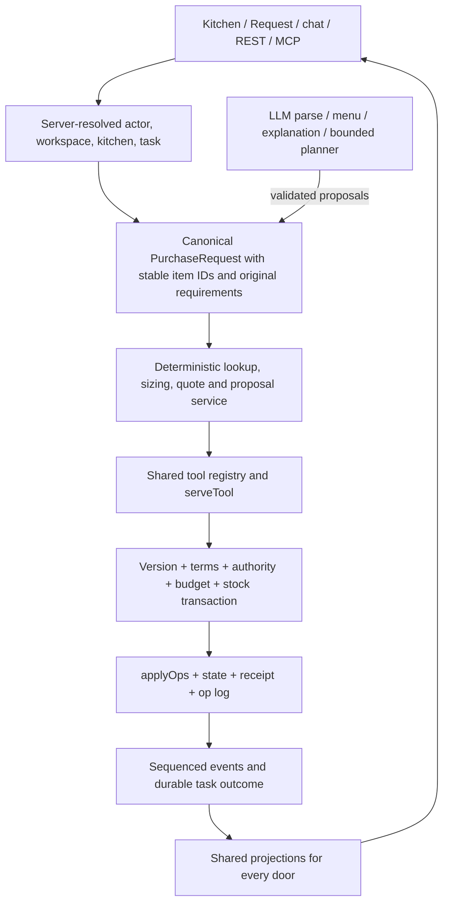

# Independent repository review — 14 November 2026

Reviewed application source at `7525df2`. During the review HEAD moved through `76e8a83` to `2a26437`; those intervening changes affect documentation only. Three isolated reviewers covered design, UI evidence, and agent/LLM execution; the primary reviewer traced core/store/data/event/release boundaries and independently ran the pure/mocked reproductions. This review did not change application code, deploy, migrate, call live providers, or touch the real database.

## Assessment

**Preserve the core architecture. The next work is consolidation and continuity.** The strongest asset is the enforceable purchasing boundary: actor scopes, immutable approval terms, server-owned command identity, transactional budget/stock checks, `applyOps`, durable receipts and sequenced events. This is substantive product infrastructure.

The highest-risk weakness is preserving what was requested as it travels through several interpretations and representations. The gate enforces the requirements it receives; chat and routine-agent paths sometimes change or lose those requirements first. Separately, each page is more complete than the transitions between pages: browser URL, kitchen selection, active request, task, and in-flight response can disagree. These two weaknesses explain much of the roughness.

The repository has 1,029 tracked files at the opening checkpoint, including 592 TypeScript/Svelte source files and 212 source test files. Their 98,121 lines include tests. Large modules span interpretation, orchestration and presentation: chat turn 1,947 lines, KitchenScreen 1,736, RequestFlow 1,530, Ops page 1,346, request execution 1,097, agent loop 979. File size is a maintainability signal, not evidence of poor runtime performance.

## Evidence boundary

- **Reproduced** below means isolated pure code or mocked provider output, with no database or paid API. It proves a reachable code behavior; it does not claim that a real provider returned the injected answer or that a production order was placed.
- **Source-confirmed** identifies an implementation path. Browser, assistive-device and production concurrency outcomes remain unverified where stated.
- Browser inventory returned `browsers=[]` and `The browser access host is unavailable`. No current interactive visual inspection or live detector overlay was possible. Historical screenshots were checked against source dates and were too old to certify current mobile composition.
- Source findings were gathered before comparing the prior Round 12 disposition. The cereal-code and contention defects independently agree with R12-02 and R12-04; the new interpretation/persistence findings extend that backlog.
- Full source review cannot certify every behavior in this repository. Provider availability, deployed configuration, real Postgres races and actual screen-reader behavior need their own opt-in checks.

## Ranked findings

### 1. P1 — Live chat can execute an unchecked model rewrite of the purchase

**Reproduced.** `chat/understand.ts:192–221` checks that model items have an amount, then renders those fields into the executable `goal`. It does not reconcile amounts, units, item identity, dietary requirements or cardinality with the original words. The preflight at `chat/turn.ts:854` validates a rules parse of the original words, while execution later selects `understood.goal` at `:975`.

Injected valid output for **“4 kg lactose-free butter tomorrow”** produced **“40 kg butter tomorrow”**. The actual preflight passed; the resolved run intent had quantity 40 and no lactose-free constraint. The purchase gate can only enforce that rewritten intent.

**Land:** one canonical request parsed from the original words; use model understanding for routing or a validated proposal. Reconcile every item before execution. Owner: Conversation.

**Acceptance:** changed amount/unit/date/kitchen, omitted diet/brand, missing/extra item and cross-assigned item quantities either preserve the original request or require a named clarification. Exercise both fixture and injected schema-valid model responses.

### 2. P1 — Routine-agent projections drop diet/brand, then omit requirements from the stored order

**Reproduced.** `agent/intent.ts:172–181,258–263`, `agent/types.ts:44,59` and `agent/routine.ts:57–70` retain a narrower shape than ParsedItem. Diet and brand disappear. For the same milk-containing Valio butter fixture:

| Original request | Shared request filter | Routine-agent filter |
|---|---:|---:|
| 4 kg vegan butter tomorrow | rejected | accepted |
| 4 kg Arla butter tomorrow | rejected | accepted |

A second seam at `agent/loop.ts:825–833` constructs `place_order` lines without `requirements` or `ask`. A lactose-free request still carrying its constraint in intent produced a line containing only product, quantity, unit and physical amount. `/request` already carries the richer fields (`request/run.ts:637–662`). Subsequent substitutions consult stored requirements (`core/services/substitutes.ts:313–328`), so initial filtering alone cannot protect later edits.

**Land:** share the complete request item and one order-line constructor across Request, chat and routine agent. Persist the original ask and hard requirements on every need, including sales-unit asks. Owner: Conversation + core contract owner.

**Acceptance:** the same request through each entry produces equivalent needs/requirements and rejects the same violating candidate before initial selection, after substitution, and at commit.

### 3. P1 — The shared requirement evaluator misses explicit cereal codes

**Reproduced.** `core/mandate/meets.ts:46–49` recognizes AW, GLUTEN and WHEAT for gluten. Its own name table recognizes UW/wheat, GB/barley and NR/rye, but those are absent from the gluten family. A product with a neutral name, declared allergens containing any of UW/GB/NR, and no free-from claim returns `ok` for both `freeFrom:['GLUTEN']` and `excludes:['gluten_cereals']`. AW correctly returns `no`.

An adjacent reproduced case: ordinary milk by name with an empty declared allergen record passes `diet:['vegan']` (`meets.ts:203–220`), even though dairy-name protection exists for milk exclusions at `:137–142`. This is an inconsistent fact policy within one evaluator.

**Land:** one normalized allergen-family/fact table used by evaluation and diet marks; conservative treatment of conflicting or incomplete evidence. Owner: Core.

**Acceptance:** each individual cereal code, trace code, missing record and contradictory free-from/diet/name record is exercised through quote, substitute and commit. Dietary constraints must survive every entry before these checks.

### 4. P1 — Recall work can be acknowledged without durable persistence or a working retry

**Reproduced persistence failure; source-confirmed webhook consequence.** `server/web/persist.ts:71` marks a document as saved **before** `sink.upsert` succeeds. `:80–84` converts rejection into a log and a resolved `stateWrites()`. A second flush with the same pending notice makes no new attempt. The probe recorded attempts **1 → 1** after a simulated database failure.

The webhook awaits this resolved barrier and returns 202 (`routes/api/web/contextdev/+server.ts:52–54,125`). There is also a cold-start ordering gap: it enqueues before `webStateReady` attaches the Postgres sink. The queue maps are hydrated once; `watch.ts:143–153` claims database IDs but filters a process-local queue, so a second instance cannot necessarily drain another instance's newly queued documents.

**Land:** await durable enqueue before 202; mark saved only after successful writes; retain dirty records on failure. Make claimed queue documents come from Postgres. Owner: web/data.

**Acceptance:** first webhook after boot, failed insert, recovery with unchanged payload, restart immediately after acceptance, and two-worker claim/drain all preserve one pending item and eventually apply it once.

### 5. P2 — Contention repair sizes a direct replacement to the full need

**Source-confirmed; no new database integration reproduction.** `core/services/contention.ts:91–120` keeps remaining stock and passes `coveredServedKg`. `core/services/substitutes.ts:261–264` computes a remainder, but its direct-need branch at `:307–308` calls `sizeDirect(p, need.amount)` on the full demand. A 10 kg direct need with 6 kg retained therefore sizes a replacement for 10 kg instead of 4 kg, before lot rounding. Make-in-house sizing also reads the full need at `:556` and deserves the same residual audit.

**Land:** a unit-aware residual-need constructor covering direct, dish, sales-unit and make-in-house strategies; validate aggregate fulfillment. Owner: Core.

**Acceptance:** keep 6 of 10, substitute only the missing 4, assert aggregate excess is below one valid replacement lot and that an approval is invalidated when terms change.

### 6. P2 — A missing equal-quantity item passes request reading review

**Reproduced.** Injecting a model parse with only potatoes for **“2 kg potatoes and 2 kg carrots tomorrow”** yields one item, an ambiguity warning, and `reviewReading: pass`. The matching loop uses `.some` for each amount occurrence (`request/reading.ts:141–159`), allowing one output item to satisfy two input asks. The parser records cardinality mismatch only as an ambiguity (`parse.ts:842–845`), which execution treats as a warning (`run.ts:882–904`).

**Land:** stable item IDs and one-to-one reconciliation; unresolved item loss blocks purchasing. Owner: Conversation.

### 7. P2 — Supported multi-item routine orders exceed the eight-step budget

**Reproduced planner sequence.** Four supported constrained items each use two search variants (`agent/loop.ts:734–741`). Eight searches consume the whole cap (`:40,362`); the first quote is action nine. The accepted example was lactose-free butter, milk and cream plus organic potatoes. No plan can be created in that run.

**Land:** perform bounded lookup/quote/sizing as a deterministic purchasing service, reserving the agent loop for discretionary decisions; or explicitly budget mandatory remaining actions. Owner: Conversation.

### 8. P1 UI risk — Async results and navigation can attach to the wrong visible context

**Source-confirmed mechanisms; browser races need execution.** Kitchen selection clears in-memory focus without replacing the old `?plan=` (`KitchenScreen.svelte:115,719–723`; `kitchen.svelte.ts:281–289`). Refresh follows the old link and the server reselects that plan's kitchen (`server/kitchen/live.ts:320`).

Chat sends the current kitchen/plan, but its stream writes to mutable task/entries after a context switch (`ChatDock.svelte:125–142,408–455`). `remember()` builds storage keys from the **new** props (`:86,110`). A late response can be saved under the next kitchen/plan. Request similarly mounts a new nonce/key on every submit (`request/+page.svelte:38–42`) while the prior fetch has no unmount cancellation/generation guard (`RequestFlow.svelte:255–301`). This establishes duplicate drafts/stale display risks, not duplicate committed supplier orders.

**Land:** canonical URL identity plus immutable per-turn/submission context tokens. Abort presentation or explicitly retain background tasks on selection changes; ignore stale responses and storage writes. Owner: Kitchen + Conversation.

**Acceptance:** request → Kitchen → switch → reload/Back/copy-link; delayed chat while switching kitchens; double submit/example replacement; delayed old Request response. The visible owner and active task must remain unambiguous.

### 9. P2 — Request workflow and receipt presentation are not resumable

**Source-confirmed.** Input, selected kitchen, submitted nonce and result are component state (`request/+page.svelte:21–49`); plan, approval and displayed commits are also local (`RequestFlow.svelte:150–169`). Refresh or navigation loses the workflow UI. Stored plans/orders remain durable and a Kitchen deep link exists. A new submission generates a new nonce, so ordinary resubmission is a new request rather than a recovered retry.

**Land:** durable task/plan URL as soon as a plan exists; restore current review/receipt; retain unfinished draft and kitchen. Owner: Conversation.

### 10. P1 accessibility risk — Sign-off needs an equivalent semantic activation path

**Source-confirmed wiring; assistive-device validation pending.** `HoldButton.svelte:15–25,47–58` only confirms after a sustained pointer or Space/Enter hold. It has no semantic click path; click-only voice/switch activation cannot perform that control's confirmation. Physical keyboard hold is supported. Kitchen sign-off uses this control (`DecisionCard.svelte:185`).

Also address the dock's missing opening/closing focus handoff and Escape path (`ChatDock.svelte:125–142,511–568`), custom tab/radio keyboard behavior, and dark faint text contrast. Authored dark colors calculate to roughly 4.01:1 on sheet, 4.41:1 on paper and 3.59:1 on well for normal text; these are token calculations, not pixel measurements.

**Land:** Review → Confirm exact terms on semantic activation, with hold retained as an optional accelerator. Use the existing accessible dialog/radio/tab primitives. Keep desktop chat nonmodal; give the phone sheet coherent focus/background semantics. Owner: UI foundations.

### 11. P2 — The fixture path is not reproducible from a public clone

**Source-confirmed.** `store/fixture-ports.ts:33` unconditionally loads the file catalogue unless a caller injects one. `adapters/catalog/valio.ts:59–74` throws without the private dataset or normalized copy. README explicitly requires uncommitted `data/valio/` for dev/evals/gate; Docker excludes it too. A clean clone or container without the production database cannot run the complete fixture-backed server path independently.

**Land:** a licensed synthetic/minimal public catalogue with representative offers, allergens, units, outages and recipes. Use it for a clean-clone smoke/CI job; keep full private-catalogue retrieval evals opt-in. Owner: Evals/data.

### 12. P2 — LLM output/retry contracts need one honest boundary

**Source-confirmed.** `core/ports.ts:118–128` has no schema field; chat/planner attach schemas through casts, while adapters only send JSON MIME or plain text (`adapters/llm/index.ts:65–76,105–112`). Local Zod validation still protects execution, but the advertised schema is not enforced by the provider. Separately, `external/call.ts:188–197` charges once around adapters that can make internal retry attempts (Decide `index.ts:235–258`, compatible LLM `index.ts:105–112`). Attempts and final token usage are not fully represented by one outer trace/charge.

**Land:** explicit job contract for response schema, output budget, finish reason and timeout; centralized attempt-level retry accounting. Retain local validation, labelled fallback and the hard caps. Owner: model/external adapters.

## System shape to converge on

This is a modular monolith worth keeping. The highest-value simplification is a common request and purchasing service, followed by shared task/query projections. A distributed agent framework would add coordination costs before the existing seams are coherent.

### Contracts and data

- Treat the original ask, its resolved requirements and partial/unresolved items as durable domain data. A fulfilled subset plan must not imply the entire original request was fulfilled; current routine outcomes only see needs that made it into a plan.
- Make identity explicit: workspace → kitchen → delivery-day plan; separate task origin and actor. The new tenancy note is useful, but seeded “customers” and app authorization remain a demo boundary, not implemented customer account isolation.
- **D23 and D24 arrived during this review.** D23's one-conversation/two-views direction fits the common request/task service proposed here; sharing a transcript alone will not repair the lost-requirement seams. D24's browser-owned stores in a shared room need a new kitchen-ownership authorization boundary first. Today CallContext and visitor resolution authorize a workspace, and `core/services/orders.ts:57–64` accepts any kitchen in that workspace. An opt-in room notice does not restrict one visitor to their own store. Add server-resolved allowed kitchen IDs/ownership, including plan-derived reads and writes, before exposing store creation/selection in a shared workspace. This is a prerequisite for the new feature, not a claim that the current deliberately shared demo room violates its existing policy.
- Separate read projection from expensive enrichment. Kitchen snapshot building (`server/kitchen/live.ts:425–445,509–518`) reruns substitute previews and opens a budget-lock transaction. With live Decide this can make routine refreshes paid or slow. Measure cold/warm snapshot latency and call counts; memoize by plan version, rules, catalogue/offer version and expiry, or explicitly request enrichment.
- Reset clears idempotency and creates a run through separate operations (`demo/reset.ts:103–110`); ordinary writes lock the workspace. Add a real-Postgres reset-vs-commit race before claiming reset is atomic across instances. This is a risk requiring reproduction, not a demonstrated duplicate order.
- Postgres TLS verification is conditional on a CA (`db/client.ts:70–77`); the fallback `ssl:'require'` disables certificate verification in the installed driver. Health reports that distinction. Production readiness should require verified configuration.

### LLM operations and recovery

- Keep model generation separate from authorization. Review rubrics can improve text and parsing but must inspect the exact command being executed, not a second parse of the original words.
- The eight-step limit, output caps, replay/rules fallbacks and trace redaction are good foundations. Add finish reasons, attempt numbers and a trace link for each accepted interpretation; preserve provenance for every fallback.
- Agent run ownership/cancellation is process-local (`agent/runs.ts:25–80`). A second instance cannot cancel the first one's run; restarts can leave an unfinished task without terminal reconciliation. When restart/multi-instance support matters, add a small persisted run/action record with a lease and recoverable terminal outcome.
- Bootstrap occurs before the agent timer; finalization clears it before optional reads/review (`agent/index.ts:52–56`; `agent/loop.ts:253–268`). A reproduced 10 ms deadline plus 90 ms finalizer returned after 94 ms as done. Bound those phases and acknowledge cancellation promptly; no post-cancel purchase was demonstrated.

### Pages and navigation

| Surface | Clear job | Main consolidation |
|---|---|---|
| Kitchen | This kitchen's tasks, decisions, deliveries and current plan | One kitchen/task identity in URL; allow kitchen selection before planning the hotel |
| Request | Capture and clarify a need; review its proposed plan | Durable task handoff and return path; reuse decision/receipt components |
| Chat | Work on the visible task and expose its progress | Immutable context per turn, kitchen name visible, canonical request underneath |
| Operations | Cross-kitchen exceptions, stakes and demand | Reuse domain projections; make reset/reconnect and stored trace history consistent |
| Agent API | Connect an outside client and show what it did | Registry-generated capability truth; same projections and revision links |
| Public site | Explain and let a visitor try a provable journey | One release claim manifest and working request-prefill/deep links |

Put the agent's completed work, unresolved exceptions and upcoming commitments ahead of the basket detail. Existing consequences, certainty vocabulary and Why disclosure support this direction. The first-use screen currently disables kitchen choice until a snapshot exists (`KitchenScreen.svelte:719–723`); `/join` is dev-only and does not complete a persisted selection. The user should be able to choose a scenario without first planning the hotel.

### Repository and release hygiene

- Split large modules at stable boundaries: parsing/reconciliation, task commands, projections and UI cards. Do it while fixing the concrete seams; arbitrary file splitting will not improve the architecture.
- There are no tracked CI workflows. The machine-wide gate is valuable, but release checks should be reproducible against a public fixture, with opt-in live/PG suites clearly separated.
- The all-source unit command also includes eval files, followed by separate eval and agent commands. The explicit reruns have a confidence value but cost several minutes; document why each layer exists and avoid additional duplicate runs during review.
- Documentation has drifted: SURFACES still says no Agent API page, subset approval is absent and Request/Kitchen are separate, while current implementation has those features. PLAN and DISPATCH predate parts of STATUS/restart; foundation notes describe startup migrations while Docker starts `node build`. Keep one short current system/action map and archive superseded descriptions.
- Public-release credential/history and data-rights work remains explicitly open in PLAN. The narrow current-tree scan only found expected example/test shapes; it is not a full history or secret audit. Do not turn that into a “secrets clean” claim.

## Independent interface critique

Method: dual-agent (`/root/ui_design_review`, `/root/ui_evidence_review`), isolated until A finished. Operate mode for app screens, Persuade for the public site. Scores are provisional source-based hypotheses; current rendering was unavailable.

**Specificity:** product-specific and worth preserving. Guests → dishes → physical demand → packs, supply certainty separate from permission, exact-term approval and consequence-led decisions are coherent. The largest opportunity is context continuity and an exception-led home.

| Nielsen heuristic | Score / 4 | Main evidence |
|---|---:|---|
| System status | 3 | Progress, decisions, stale-state recovery; async context race |
| Real-world language | 3 | Kitchen quantities and supply vocabulary; some technical receipt text |
| Control and freedom | 2 | Request restoration and sign-off activation gaps |
| Consistency | 2 | Shared tokens/cards, different Request approval and navigation behavior |
| Error prevention | 2 | Strong exact terms; weak client task/context continuity |
| Recognition over recall | 2 | Why is available; returning to a request needs recall |
| Efficiency | 3 | Inline edits, preferences, per-decision actions |
| Minimalism | 2 | Good disclosure; first-use explanation and overlapping Ops views |
| Error recovery | 2 | Kitchen retry is good; Request recovery/restore weaker |
| Help | 3 | Contextual Why, mandate and agent setup |
| **Total** | **24 / 40** | **Provisional; no visual or conformance certification** |

Five UI priorities: (1) bind kitchen/plan navigation and late responses to one identity; (2) restore Request review/receipt across interruption; (3) provide semantic sign-off and coherent dock focus; (4) complete first-use kitchen selection; (5) verify density, contrast, tabs and touch use at 1440/390 after those foundations. Appropriate Impeccable passes are harden, onboard, clarify/layout and then polish.

Preserve three strengths: consequence-first decision cards, separate supply/authority semantics, and progressive disclosure with the accessible Why dialog. The detector completed with six side-border style warnings across four files; these mostly mark semantic status treatments, including a clear false positive on the make-in-house AND bracket. They are not six functional defects and should not drive a cosmetic rewrite.

Persona risks: a first-time chef must infer context while moving between four doors; a returning phone user loses the visible Request/receipt; a voice/switch user cannot activate the required hold control through a click; a power user can outpace async responses by switching/submitting again. The emotional low point is uncertainty about which request is active, especially after an approval or interruption.

## Recommended landing sequence

1. **Preserve intent:** findings 1–3 and 6; shared canonical request and line construction; cross-entry equivalence on diet, brand, amounts, units and missing items.
2. **Make effects recoverable:** durable recall enqueue/retry, residual contention, exact task ownership, bounded routine execution.
3. **Make the journey continuous:** canonical kitchen/plan/task URLs, response-generation guards, restored Request review/receipt, accessible confirmation and dock focus.
4. **Show the product's value:** kitchen exceptions and agent work first, one complete shortage → repair → review → receipt journey; basket detail beneath it.
5. **Make the release reproducible:** public fixture + CI, current architecture/action/claim map, then current browser and opt-in PG/live verification.

Avoid widening the feature surface until the first three are proven. The existing pure core and transactional tool boundary give this consolidation a good place to land.

## Verification record

Reproduction scripts and raw review evidence are retained under gitignored `scratch/repo-review/`; this report is the durable repository deliverable.

- Primary review: type check, lint and 31 eval self-tests passed in fixture mode; its redundant heavy steps were stopped while queued behind the existing main gate.
- Concurrent main gate at `8e86190`: **GREEN, seven steps**; same application source as the reviewed commit, verified by source/config/script diff. Build passed; unit suite 1,237 passed / 9 expected fail / 43 skipped / 6 todo; scenario suite 135 passed / 9 expected fail / 27 skipped / 6 todo; agent suite 22 passed / 144 skipped (name-filtered). The scenario/agent figures overlap the all-source unit suite and must not be added as unique test coverage. Raw evidence: `scratch/gate-main-8e86190.log`.
- Isolated reproductions: original→rewritten chat request, routine diet/brand loss, missing persisted requirements, equal-amount item omission, step-budget exhaustion, finalizer deadline, cereal/diet evaluator and failed persistence retry.
- Browser suite: attempted through `pnpm gate --only e2e` after the other gate finished; it remained at `playwright install chromium` and did not reach test execution. Stopped with the execution-session interrupt; its processes and machine lock were cleared. Direct `playwright test --list` succeeded and discovered 29 tests in 10 files; compatible Chromium is already cached. No browser test passed or failed in this review, no fresh screenshots were generated, and this is not a release-ready UI claim. Raw attempt: `scratch/repo-review/e2e.log`. No review server or browser overlay remains running.

## Questions for the next implementation brief

1. With identity/recovery defects and an exception-led home both evident, should the next pass prioritize **correctness and continuous journeys**, **Kitchen home structure**, or **a narrower demo landing pass**?
2. Given the blocked public-clone fixture and current single-process run ownership, is the target **a dependable hackathon demo**, **a reproducible public repo**, or **a pilot-ready service**? The first three landing steps remain useful for every choice; the deployment/fixture work scales with the answer.
