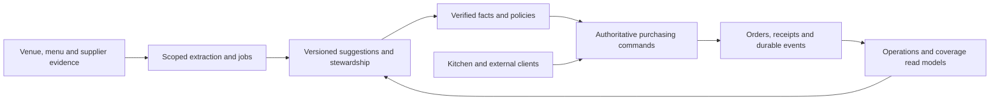

# Mandate: quality of the whole product, and the path to Finland

14 November 2026. Consolidated review by the primary reviewer and three specialist subagents. Main changed from `c834e98` to `451a713` during the sweep; overlapping findings were rechecked. This is a proposed direction and executor handoff, not an edit to lead-owned PLAN/DECISIONS or application code. No secrets, private recordings or shared-database mutations were used. The browser access host was unavailable: UX findings are source-based, not a rendered visual or accessibility certification.

**User priority incorporated:** nationwide venue discovery and honest demand simulation first; usable ordering for arbitrary kitchens follows. Keep the larger platform ambition. Improve the depth and interaction of its pillars rather than accumulating sponsor features or declaring every route “done.”

## The decision

Mandate should become **a purchasing decision system with a visible operating model**. Its chef, operator, data steward and outside agent all work on the same versioned facts, requirements, decisions and commitments, with different authority and different views.

The right expansion is not “the demo works, now add thousands of dots.” It is:

1. A verified purchasing journey for a curated kitchen.
2. Several meaningfully different kitchen profiles and a useful operator workflow.
3. A growing national directory and simulation, visibly exposing its evidence gaps.
4. A data/enrichment process that resolves those gaps and admits additional kitchens to shadow planning.
5. Operational ordering only for sites with the necessary data, authority and supplier arrangements.

That keeps the scope large while making each addition strengthen the same product. **Discovery coverage and purchasing readiness advance independently.** A new menu source can improve the directory before its recipes are safe to order; an excellent pilot kitchen can transact before its whole region has been mapped.

Specialist evidence and detailed fixes:

- [Agent quality, authority and evaluation](ROUND4-AGENT-QUALITY.md).
- [User journeys, surfaces and UX](ROUND4-UX-QUALITY.md).
- [Systems quality and growth architecture](ROUND4-SYSTEMS-QUALITY.md).
- [Round-three reproduced purchase defects](REVIEW-GPT-6-ROUND3.md), retained as regression cases, not assumed all still open.

## Six pillars, with a definition of good

These are continuing responsibilities, not six new apps. Use this table to review work and assign ownership.

| Pillar | Checkbox version | A good version | Proof before calling it good |
|---|---|---|---|
| **Purchasing truth** | Prices, stock, an approval button | Quantities, packaging, yields, delivery promises, constraints and authority agree from need to receipt; unresolved supply stays explicit | Edit-after-rescue, missing-price, unit mismatch, duplicate selections, concurrent stock/budget and stale-approval cases |
| **Bounded agent judgement** | Long prompt, tools and an eight-step loop | Understands supported intent; retrieves appropriate evidence; chooses permitted actions; asks or abstains; finishes against a domain goal | Repeatable outcome tests and authority attacks, with live/replay/rules distinguished |
| **Kitchen co-planning** | Dashboard plus chat | Chef can request, compare, revise, decline, approve, return after interruption and understand what remains unsupplied | Complete phone/desktop journeys including failure, partial commit and concurrent edits |
| **Operations and governance** | Live event wall and admin buttons | Operator owns and resolves exceptions; steward reviews data/policy changes; each action has scope and an audit consequence | Case → exact need/plan → assigned resolution → updated kitchen; governed correction cannot silently change approved terms |
| **Coverage and enrichment** | Every venue has generated fields | Locations, menus, recipes and ordering readiness have separate provenance, freshness and verification; gaps drive useful enrichment | Held-out venue/menu samples; correction workflow; measurable useful fields gained without unsafe assertions |
| **Reliable shared platform** | Ports, Postgres, MCP and tests exist | One domain engine, resource-scoped interfaces, durable jobs/events, bounded work and recoverable failures; changes have a predictable owner | Transport parity, restart/reconnect, job retry, resource isolation and bounded-load tests |

A mature pillar does not compensate for an unsafe neighbour. Model quality cannot rescue incorrect units; a beautiful approval card cannot supply missing prices; a national map cannot establish supplier delivery coverage.

For every capability track three separate states: **implemented**, **verified as a journey**, **operated with evidence**. A source-backed test can verify a refusal; it cannot prove that chefs understand it. A screenshot can establish layout; it cannot establish commit integrity.

## Immediate boundary fixes before broad integration

The live Kitchen is real progress: the served UI now uses server-mediated tools and a view built from the real plan. Post-approval commit selection and recognition of `UNKNOWN_REQUIRED` also improved. Do not repeat the old “everything is browser fixture” claim. The new seams deserve explicit ownership:

| Priority and owner | Evidence / implication | Next concrete gate |
|---|---|---|
| **P0 lead + core-db:** purchasing invariants | Round-three probes exposed duplicate selected IDs, unknown-price commitment and missing constraint enforcement | Re-run those cases on the new SHA; close with invariants, not only the original five scenarios |
| **P0/P1 agent + browser bridge:** authority | `live.ts` reconstructs a global chef context for `/kitchen-api` calls; its module-wide kitchen/preset selection is shared ([live.ts:23](../../src/lib/server/kitchen/live.ts#L23)). Role filtering on MCP alone cannot protect a separate public chef bridge | Deliberately isolated demo session now; authenticated member/site grants before pilot; no unauthenticated public route may become a general approval API |
| **P1 kitchen + core:** reads versus commands | GET snapshot calls `ensurePlan`, creating a plan and proposing rescues ([live.ts:50](../../src/lib/server/kitchen/live.ts#L50), [80](../../src/lib/server/kitchen/live.ts#L80)) | Snapshot is read-only; explicit `start/replan` command causes work. Opening a second tab does not write or consume model budget |
| **P1 kitchen:** recovery | Snapshot failure switches to an independent browser fixture ([backend.ts:12](../../src/lib/kitchen/backend.ts#L12)) | Timeout after commit enters “outcome unknown—checking receipt,” not a second purchasing world. Offline simulation is explicit and isolated |
| **P1 core-db:** transaction preparation | Requote/catalogue reads occur under workspace lock using the other pool; three pooled connections can be occupied by waiting transactions | Prepare outside lock, validate versions inside, use transactional handles for local critical reads; tiny-pool concurrent requests settle within a bounded deadline |
| **P1 ops:** replay/reset | Catch-up applies LIMIT before run filtering ([bus/index.ts:101](../../src/lib/server/bus/index.ts#L101)); Kitchen reset and Ops fresh-run behaviour differ | Fresh run remains visible after >1,000 historical events; one documented reset action, no historical deletion |
| **P1 agent:** actual judgement | Decide is now constructed, but substitution service still does not pass recipe-fit decisions into ranking at this snapshot | One actual model judgement affects an appropriate choice; fallback and uncertainty appear honestly |

The pool issue is a code-inspected concurrency risk, not a measured outage. The specialist report explains the dependency. Fixing it is cheaper than diagnosing an apparently random frozen demo after more lanes add model work.

Keep the modular monolith. Do not solve these with a new microservice, agent framework or universal rules engine. Move preparation outside transactions, centralize domain validation and make projections explicit.

## Tool scoping: the levels that matter

The user's distinction is correct: “we have scoped tools” can describe very different systems. Require several cumulative boundaries:

1. **Instruction:** explain role, task and stopping conditions. This helps the model, but grants no authority.
2. **Visibility:** expose only tools useful to this role and current task. Retain a human handoff when an action is unavailable.
3. **Server enforcement:** the same forbidden action fails through MCP, REST, agent loop and browser helpers—even if called directly.
4. **Resource scope:** bind principal to organization, kitchen/site, buyer account and run. A kitchen A key cannot read or change kitchen B merely by guessing an ID.
5. **Workflow scope:** research can retrieve; planning can propose; commitment requires exact valid terms and mandate/approval. Do not give every phase every role-permitted tool by default.
6. **Explicit delegation:** an authorized person may start a kitchen agent only through a recorded grant specifying resources, limits, lifetime and initiator. Starting an agent must not silently transform an approver into a purchaser.
7. **Action authority and lifecycle:** enforce version/hash, expiry, revocation, idempotency, budgets and current facts at execution; stop/cancel/reset semantics remain effective during slow calls.

Current strengths are visibility filtering, server checks and exact-term commitment machinery. Current gaps include resource grants, phase boundaries and delegation: the agent-run endpoint authenticates a caller, then reconstructs a global kitchen agent rather than preserving the caller's authority. The specialist also reproduced a tool dispatch after the configured deadline; check deadlines **after** slow planning and **before** execution, with cancellation/deadlines propagated through providers.

Prefer a bounded workflow with model judgement over one giant autonomous prompt. Define a task result such as `planned`, `needs_clarification`, `blocked`, `partially_committed`, `committed`, `cancelled`, with domain-derived reasons. The model's “done” summary is not the success condition.

Untrusted menu/product text may inform extraction or suitability; it cannot define permissions, raise caps or become instructions to an ordering tool. A typed wrapper or a hidden tool reduces risk but is not a complete trust boundary. Separate evidence-reading contexts from authority-bearing execution, and validate all resulting proposals at the core.

## The surfaces and the interactions between them

Keep one design system and shared domain components, with different task-focused homes. Administration can live under the same Operations shell with separate permissions; it need not become a separate application this weekend.

| Surface | First screen / primary question | Primary action and handoff |
|---|---|---|
| **Kitchen workspace** | “What needs my decision before delivery?” | Request/edit plan → compare → review consequences → authorize exact terms → receipt; communication attached to the need |
| **Operations** | “Which exceptions threaten service, and who is resolving them?” | Urgency/impact queue → exact kitchen need/plan → assign/escalate/resolve → kitchen sees the result |
| **Coverage explorer** | “Where do we have evidence, and where is it missing?” | Region/map + synchronized list → venue evidence → choose bounded simulation or enqueue enrichment |
| **Data/policy administration** | “Which change can I safely publish?” | Review raw sources and suggestion → validate → publish version → affected draft plans revalidate |
| **Developer doorway** | “Can my client complete a permitted task?” | Scoped sample client → structured status/refusal → approval link → receipt, with assumptions and capabilities documented |

Operations is not the same job as administration. An operator can coordinate a shortage without editing catalogue truth or granting credentials. A data steward can correct packaging without approving a kitchen's purchase. A chain purchaser can govern several sites without seeing other customers' orders. Make these differences visible in navigation and capabilities.

For the chef, show **what changes, why, price basis, delivery, supplied portions and remaining uncertainty** before the terms hash. Keep the hash/version in evidence detail. Show draft/preview, applied proposal, approved terms, supplier acceptance and fulfilment as separate states; do not compress all into “approved.” The source-based UX review identifies mobile comparison, assistive confirmation and exact-plan drill-down as the next high-value improvements.

## Twelve journeys to organize the work

Use these as integration tests and user-observation scripts. They extend PRODUCT's stories with transitions that make the parts work together.

| User and situation | Acceptance that establishes quality |
|---|---|
| Chef requests “milk by Monday” | Interpreted date, product requirement and quantity basis are visible; ambiguity asks one focused question; no silent Christmas fallback |
| Chef changes portions after rescue | Active replacement and ingredient quantities, lots, price and portions recompute; prior approval invalidates; preview is not presented as applied |
| Chef declines an option | Choice is retained as feedback with source/expiry, not a new permission; another option/menu revision is possible; no repeated immediate proposal |
| Purchaser loses connection during commit | Retry/status lookup finds the original outcome; no duplicate or automatic transition to independent fixture authority |
| Second client edits during review | Exact changed fields highlighted; user intent preserved; stale approval cannot release new terms |
| External agent attempts approval elsewhere | Refused across all transports and helper routes; real human handoff shows actor and exact action |
| Operator receives a regional shortage | Case has owner, affected needs, deadline and next step; drill-down reaches the exact plan; closure requires evidence |
| Steward receives a suspicious pack value | Raw packaging levels and sources visible; correction/suggestion is versioned; accepted change affects new validation, not old receipts |
| Analyst explores an unprofiled municipality | Observed venues, segment gaps and dates visible; absence is not reported as zero demand; bounded simulation assumptions editable |
| Enrichment worker sees a menu PDF | Extracted fields link to page/crop; unsupported quantities stay unknown; a reviewed mapping is required before purchasing use |
| Admin revokes a kitchen agent mid-run | Next protected action fails with a recoverable reason; earlier committed order remains; another kitchen's work continues |
| Pilot kitchen reports a short delivery | Ordered, supplier-accepted and received quantities differ explicitly; residual need opens a case and a new proposal without rewriting history |

The last two are pilot-level stories, not a demand to finish every flow this weekend. Their contracts influence today's authority, receipt and event models.

## Finland first: a coverage product, not a claim of universal ordering

Today the parsed venue corpus covers **Helsinki, Espoo and Vantaa**, not Finland: 3,560 venues; 15 structured menus; 574 dishes. Most covers are estimates, and institutional kitchens/care/catering are poorly represented. Exa found useful pages but also wrong-country/same-name matches. These limitations are explicit in [venues.md:18](../research/venues.md#L18), [21](../research/venues.md#L21), [36](../research/venues.md#L36), [47](../research/venues.md#L47). The fetch script currently enumerates three cities ([fetch_osm.py:18](../../scripts/venues/fetch_osm.py#L18)).

**First expansion:** a partitioned, resumable directory import by municipality/region, with stable source identities, deduplication review, source/fetch dates and a manifest of what was attempted. Avoid a single giant query or a full-country live scrape at demo time. Counts mean “observed in this corpus,” not market share or a complete national census. Publish uncovered regions and unsupported segments as gaps.

Do not seed every discovered point as an actual customer. Keep separate:

`Public Venue ↔ external identities → Kitchen Site → Organization/Membership → Buyer Account/Supplier Agreement → Mandate/Plan/Order`.

For the initial directory/simulation, only Venue, source identity, profile hypothesis and evidence readiness need concrete records. Add buyer accounts and agreements when onboarding requires them. An organization can have many venues; a venue can host several operating kitchens; a public chain menu does not automatically apply to every site or date.

**Coverage is a vector, not one green badge:**

- Location/source observed, with duplicates and freshness known.
- Menu found and applicable to this venue/date/service.
- Dish extraction complete enough for exploration.
- Recipe/yield/SKU mapping reviewed for specified dishes.
- Delivery/customer offer context and stock inputs configured.
- Policy/identity verified; shadow plan tested; act mode explicitly enabled.

Show counts at each stage and **why** a venue cannot advance. For unknown menus or uncertain dish composition, profile-based simulation remains available with a visible estimate label; ordering does not. Display simulated demand separately from observed transactions, using ranges and sensitivity rather than false precision.

**Nationwide affordance:** regional overview → accessible filtered venue list → evidence/readiness profile → either “simulate with assumptions,” “resolve this data gap,” or “open authorized kitchen workspace.” Clustering and aggregation make a map readable; an exception queue makes Operations actionable. A 500-agent animation is optional evidence of workload capacity, not evidence of 500 functioning customer relationships.

## Enrichment: useful product work for Exa, Context.dev and multimodal models

Make enrichment demand-driven and reusable:

`gap identified → source discovery → identity/applicability verification → extraction → validation → suggestion → review/publish → dependent draft revalidation`.

Exa finds a likely official menu/manufacturer specification. Context.dev extracts and monitors relevant known sources. A multimodal reader handles a scanned PDF, posted menu image or chef-uploaded document when ordinary extraction misses information. The operator sees the evidence and confidence per field, not an opaque “enriched” percentage. Route by input difficulty and measured quality, not sponsor logo.

Prioritize gaps by the task they unblock, number of affected plans/sites, authority of obtainable evidence, and cost/latency. Finding a missing recipe quantity needed for tomorrow's order is more valuable than inventing carbon for non-food products. Deduplicate work by source/version; a chain menu is fetched once but applied to sites only after applicability checks. A conflicting pack size must not be resolved by model confidence alone; inferred allergen clearance never becomes verified safety data.

**Google Maps menu photos:** potentially useful imagery, but not a dependable menu-ingestion foundation. The official Place Photos interface returns photos from varied sources, requires attribution where supplied, and photo resource names can expire; the documentation does not promise a current applicable menu for a venue. [Google Place Photos documentation](https://developers.google.com/maps/documentation/places/web-service/place-photos). Its policy documentation also restricts storage/extraction/derived use subject to applicable terms and exceptions; do not assume a Maps-derived persistent menu corpus is permitted. [Google Places policies](https://developers.google.com/maps/documentation/places/web-service/policies#data-storage). Prefer official venue menu pages/PDFs or permissioned uploads for the first multimodal path. Verify applicable source permissions before building a reusable imagery dataset; this review does not establish them.

This creates a stronger Nemotron/Cloudinary use if introduced later: document → visible crop/field evidence → reviewed event/recipe → changed plan. It does not require another stand-alone feature. Photographs of dishes do not establish ingredients, allergens or recipe yields.

## Architecture and code quality that support that direction

Keep **one authoritative purchasing engine** and many projections. The server/core owns truth; browser view models own presentation; adapters translate sources; jobs create suggestions, not a parallel catalogue authority.

**Maintainability means changing one rule in one place.** Shared domain checks should drive tiering, ranking and commitment. Shared recipe sizing should live in pure demand code, not be copied across services; the latest product-resizing fix creates an events/substitutes import cycle, and make-in-house resizing remains separate. Fixture data should exercise the same rules. If a browser-only simulation remains for design, isolate it with explicit mode and no ambiguous continuity with real receipts.

Before useful enrichment: define a durable job/result lifecycle, retries, deduplication, partial progress, evidence/suggestion records and publication version. `RecordEnrichment` in the reducer is insufficient if suggestions cannot be reloaded or used after restart. Before a multi-site pilot: replace full-workspace reconstruction per command with targeted plan/budget/stock repositories, validate/version persisted JSON documents, and derive dashboards from paginated read models. Keep the simple workspace lock for a small verified demo while measuring it; do not place all Finnish activity behind one ever-growing lock/load.

Identity/site context and freshness must reach offers and caches. The current static mock legitimately ignores customer/date, but the future `OfferContext` needs authenticated buyer account, delivery site, agreement and requested date. Never let a public venue name choose another customer's price context. Separate operational accounting from disposable simulation runs so reset cannot reset real weekly spend.

## Revise the roadmap by quality gates, preserving D4

| Stage | Scope to pursue | Gate to advance | What remains explicitly limited |
|---|---|---|---|
| **Ring 0: trusted decision** | Complete Christmas/milk journey, outside client, real Kitchen/Ops parity | Purchase invariants; edit-after-rescue; exact authority; unambiguous recovery; useful receipt | Curated recipes/products, challenge mock, labelled simulator |
| **Ring 1: work across kitchens** | Three contrasting profiles, operator drill-down, one live web-triggered action | Different mandates yield valid different outcomes; a case can be resolved end-to-end; source change cannot silently release an order | Representative cohort, not all venue types |
| **Ring 2A: national discovery/simulation** | Directory partitions, evidence readiness, region exploration and bounded scenarios | Coverage denominators/freshness visible; repeatable imports; simulation ranges/assumptions; no listed venue implicitly gets purchasing authority | Geographic evidence coverage, not universal customer onboarding |
| **Ring 2B: reusable enrichment/proof** | Durable Modal jobs, useful model tasks, quality review and Lab | Restart/retry retains results; validated improvement on held-out cases; downstream plans actually benefit | Estimates and unsupported capabilities remain explicit |
| **Ring 3 / shadow pilot** | Arbitrary kitchen onboarding within supported recipe families; separate Personal module if pursued | Own menu/stock/delivery/policy; permissioned scope; repeated shadow outcomes; receive/short-delivery feedback | No act mode merely because onboarding form is filled |
| **Regional → national operation** | More regions, segments and buyer agreements | SLO/load/recovery tests, per-site success, revocation/quotas, service calendars, multilingual and long-tail audits | Publish capability gaps by segment and geography |

2A and 2B can run in parallel after a stable Ring 0/1 spine. Build coverage exploration first as the user requested; enrich gaps where it provides measurable value. Neither blocks fixing the kitchen experience. National geographic coverage can exist this weekend as an honestly bounded directory demonstration; nationwide operational readiness is a later evidence-based rollout, not a timetable promise.

## Executor packages and review discipline

Estimates below are rough implementation effort for bounded packages, not additive elapsed time or delivery promises. Active executors should reconcile them with their branch state.

1. **Lead/core, now: one validator and command/read split.** Close remaining round-three invariants; snapshot reads stop initiating plans; prepare outside locks. **1–3 h**, depending on already merged repairs. Gate with adversarial direct tool cases and a tiny-pool test.
2. **Agent, parallel: authority and outcomes.** Preserve initiator/delegation, target resource scope, effective deadline/cancel and domain completion; use real decision scores only for suitable judgement. **1–2 h for the demo boundary**, fuller resource/delegation model during pilot. No new agent framework.
3. **Kitchen/Ops, parallel: one truthful journey.** Fix preview/applied distinction, explicit recovery/mode switch, consistent reset, mobile comparison and accessible confirmation; add exact-plan drill-down. **2–4 h combined**, verify in actual critical states rather than empty-page screenshots.
4. **Data/coverage, after contracts stable: directory readiness slice.** Venue/evidence identity schema, region/list/profile, one missing-field enrichment handoff and honest simulation. **1–2 h design/contract agreement**, implementation split into separately reviewable slices; national ingestion duration remains unmeasured.
5. **Jobs/stewardship: durable useful batch.** Job/suggestion storage, idempotent callbacks, partial/retry handling and reviewed use. **2–4 h minimum seam**, then measure extraction quality/cost on a representative batch before expanding.
6. **Pilot architecture, later:** targeted repositories, schema evolution, real membership/buyer context, operational receiving and cross-instance lifecycle. Budget **days and measured milestones**, not “one more overnight lane.” Preserve the existing stack and tests.

Put adopted tasks in the existing PLAN; this report must not become a second status board. Each brief names its user journey, invariant, owned paths, fixture/real source, failure case, acceptance command, screenshot/state evidence and deployment SHA. The lead owns shared semantics; peer reviewers verify the whole interaction, not just their lane's code. Refresh STATUS from actual merges so completed fixes do not remain stale blockers.

Keep separate evaluation tracks: domain invariants, transport/identity parity, deterministic workflow, real-model outcomes, user comprehension/accessibility, and data/job/load quality. A hundred unit tests, five scripts or a calibration-looking chart do not substitute for the other tracks. Count unsupported requests and abstentions; reward feasible fulfilment under policy, not mere refusal or tool activity.

**The strongest next proof:** a judge changes a portion or requirement after a real rescue; the purchase changes correctly, approval invalidates, the operator sees why, and the system either supplies the requirement or clearly assigns the unresolved gap. Zoom out from that exact kitchen to the region's evidence/readiness view. That demonstrates the larger product's depth and direction without claiming the rest of Finland is already operational.
