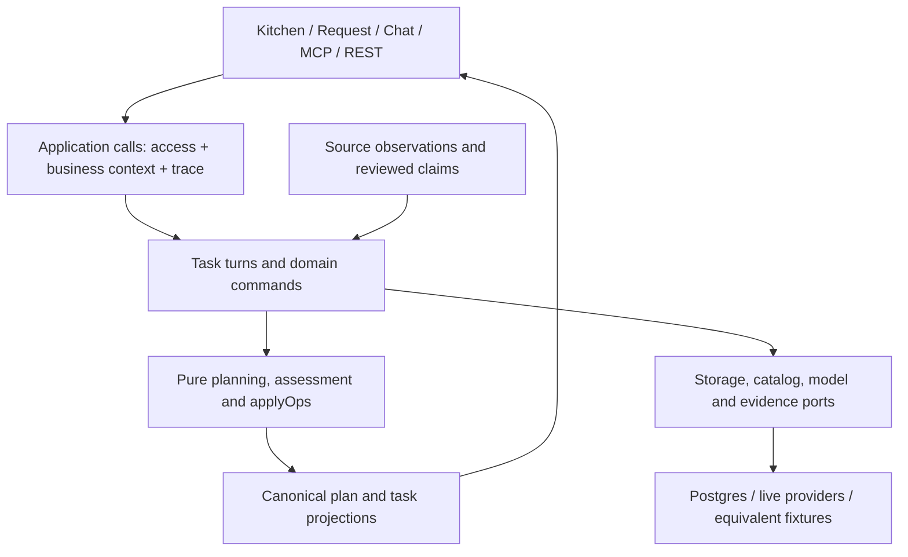

# Round 8: architecture, consistency and maturity

**Snapshot:** `50575b357d8eca076063d739991f80c795af15b9`. Scope: current implementation and the transition to more kitchen sites/customer accounts, live evidence and a useful in-app agent. Source inspection plus eight isolated observation probes; no application changes. Links point to repository paths; line references and behavior refer to the snapshot, which remains under `scratch/round8/snapshot/`.

Sizes below describe breadth: **S** is a local correction; **M** crosses a service, storage or entry-point boundary. They are not time estimates. Priorities concern the next expansion, rather than claiming the demo is a production service.

## 1. Task persistence and command identity are disconnected — P1, M

**Observed.** Two fresh chat turns containing “Order 4 l lactose-free milk for Thursday” produced different task IDs, both referring to the same plan; only one order existed. The scripted planner derives its idempotency key from kitchen, query, quantity, unit and date. It has no task/turn identity. Similar words are being treated as the same business operation.

A second probe injected a `STALE_VERSION` result from the final task write. Purchasing completed first: one order existed, the task store was empty, and the final message said the task had changed in another window and should be reloaded/retried. The message even retained the derived `done` state. This probe demonstrates the ordering defect; it does not establish how often a real database failure or concurrent turn occurs.

**Why it happens.** [chat/turn.ts](../../src/lib/server/chat/turn.ts) creates a task in memory, runs tools, yields steps/ledger, and only then calls `store.put` around line 351. The task's compare-and-set protects the final row, after the business effects. The agent run's process-local workspace lock is not a durable task reservation; the `continue` branch uses a separate script. [agent/loop.ts](../../src/lib/server/agent/loop.ts), around line 548, constructs the content-derived key.

**Correction shape.** Persist the task and accepted input/turn ID before starting side effects. Reserve a task version or active turn with a short transaction. Commands get durable operation IDs anchored to task + turn + command, with results recoverable after a lost response. A repeated transport request reuses that ID; “another purchase” creates a new intent. Do not hold a database lock across a model call. Keep task metadata and purchasing state as distinct records with an explicit recovery relationship.

**Verify.** Same turn retried after disconnect produces one operation; two explicitly new tasks produce two independent intents; failure after commit but before final task projection recovers the existing receipt without inviting a second purchase; concurrent continuations across two processes cannot both execute the same turn.

## 2. Resource authorization depends on the caller's path — P1, M

**Observed.** With `kitchenIds: ['k-hotel']`, `get_plan` successfully returned a `k-lounas` plan and `place_order` successfully created another plan there. `createGetOutcome` refused the same plan. The test used a server-derived context shape and real PGlite-backed handlers.

**Boundary.** [core/services/handlers.ts](../../src/lib/core/services/handlers.ts) validates schema and action scope, but does not enforce `kitchenIds`. The agent loop, context reader and [tasks/outcome.ts](../../src/lib/server/tasks/outcome.ts) add their own resource checks. Workspace isolation is useful and remains distinct from membership within a multi-site workspace. Existing unrestricted demo credentials make this a site-grant contract gap; this review did not demonstrate a cross-workspace bypass.

**Correction shape.** Resolve the target resource and check membership in the shared application service boundary for reads and commands. For an ID-based approval/order/plan call, authorize the stored resource, not a supplied kitchen ID. Carry authenticated membership into every entry point. Agent permissions remain the intersection of initiator and service actor; the model never constructs grants.

**Verify.** One table-driven matrix covers UI-backed APIs, REST, MCP and chat: authorized site, another site in the same organization, another workspace, expired/revoked membership. Include plan reads, plan creation, edits, approval and commit, rather than only discovery filtering.

## 3. Database-backed web state has file-cache failure semantics — P1, M

**Observed.** Injecting an upsert failure into [web/persist.ts](../../src/lib/server/web/persist.ts) caused an error log, but `stateWrites()` resolved. Repeating the same queue addition caused no second write: the failed value had already been marked saved. The webhook awaits this function before returning 202, so the awaited condition is settled attempts, not successful durable acceptance.

A separate probe made the worker claim a database queue ID absent from its local map. It released the lease without reading the notice. [web/watch.ts](../../src/lib/server/web/watch.ts), lines 136–144, intersects claimed IDs with local `queue.due()`. [web/pg-state.ts](../../src/lib/server/web/pg-state.ts) returns IDs from the lease query; startup hydration in [web/index.ts](../../src/lib/server/web/index.ts) happens once per process. SQL leasing alone therefore does not make the whole worker coherent across processes.

There are additional source-level concerns, not separately race-tested: upserts start before the promise chain waits for them, so the chain does not serialize writes; hydration preserves existing local values; and required storage initialization failures fall back to files. A response cache can tolerate best-effort persistence. A queue acknowledgement, recall application record or shared spend boundary needs an explicit failure policy.

**Correction shape.** Introduce a small asynchronous repository contract: durable enqueue, claim returning the full versioned item, and acknowledgement/retry conditional on lease ownership. Required writes reject on failure; saved markers advance only after success. Memory/file fixtures implement the same result contract. Keep optional response caching separate. This can use the existing Postgres tables and leases; it does not require a new queue service.

**Verify.** An item enqueued on process A is processed on already-running B; a database outage prevents a successful durable acknowledgement; a recovered worker processes the item once per application identity; an expired owner cannot acknowledge a newer lease. Retain the existing atomic spend-counter tests.

## 4. Centralized projections have incomplete inputs and inconsistent readers — P2, S–M

Three probes exposed different manifestations:

| Observation                                                                                  | Source                                                                                                                                              | General correction                                                                                                                                                                           |
| -------------------------------------------------------------------------------------------- | --------------------------------------------------------------------------------------------------------------------------------------------------- | -------------------------------------------------------------------------------------------------------------------------------------------------------------------------------------------- |
| A ledger containing 2 kg flour and 3 l milk says “5 needed; 5 planned.”                      | [tasks/ledger.ts](../../src/lib/server/tasks/ledger.ts), `ledgerTotals`; [tasks/outcome.ts](../../src/lib/server/tasks/outcome.ts), `ledgerSummary` | Preserve quantities per need; group compatible units/bases or summarize counts. Removing the unit does not make addition valid.                                                              |
| A task detail projects `done`, while the same task remains `awaiting_chef` in the open list. | [tasks/project.ts](../../src/lib/server/tasks/project.ts), `get` projects but `list` delegates unchanged                                            | Apply the same projection to list/detail, and define how current derived state affects filtering and pagination. Avoid filtering stale states before projection and silently losing results. |
| A held line with `view.committable: true` still tells the client it waits for a chef.        | [agent/next-action.ts](../../src/lib/server/agent/next-action.ts), held-line count                                                                  | Derive suggested actions from current validity, permissions and grants, not the stored line enum alone.                                                                                      |

The task projection separately recognizes granted approvals and sets `canContinue`, creating a route for a continue button and the written next action to disagree. `get_context` supplies stored plans to the same next-action function, while `get_plan` enriches them with current read views. A shared helper cannot establish parity when callers supply different levels of truth.

Multi-plan semantics also need a decision before expansion. A task records `primary`/`touched` plan references; the ledger aggregates all referenced plans, while pending/state/action projection uses the first. “Referenced during investigation,” “alternative proposal,” and “active fulfillment contribution” are different relationships. Define those roles before summing their quantities or allowing one completed plan to determine a task's state. This last issue is source-inspected, not an additional runtime probe.

**Verification target.** One canonical task query returns current active plan contributions, unit-aware ledger, pending decisions and allowed actions. UI copy, agent facts and MCP metadata format that result. Exercise partial grants, expiration, two active plans, an abandoned alternative and a task completed from another screen.

## 5. Live supplier calls lack per-account operational context — expansion gate, M

[Catalog.offers](../../src/lib/core/ports.ts) accepts IDs and delivery date; it has no buyer account, kitchen or agreement. [catalog/pg.ts](../../src/lib/server/adapters/catalog/pg.ts) and [catalog/valio-live.ts](../../src/lib/server/adapters/catalog/valio-live.ts) capture one customer, defaulting to `123`. [server-ports.ts](../../src/lib/server/store/server-ports.ts) constructs one catalog for the process without selecting a buyer per request.

The PG catalog intentionally re-dates offer availability through `onScenario`, including live-fetched offers, and its comment explains that the supplied API ignores requested date. The server composition installs the simulated overlay and scenario clock. These are reasonable demo accommodations and real live calls, but they do not establish actual site-specific delivery terms.

**Correction shape.** Resolve two explicit contexts at the edge:

- **Access:** authenticated principal, workspace/organization, memberships and effective permissions.
- **Business execution:** kitchen/site, buyer account, supplier agreement, requested delivery, operational clock and demo/shadow/operational mode.

Use only the relevant slice at each port. A quote identity and cache must include the terms that affect it; a scenario decorator may deliberately transform those terms in demo mode. Do not infer a buyer account from workspace, or turn a public venue into an account. Begin with two sites and the existing supplier. The entities already described in [GROWTH.md](../concept/GROWTH.md) are a good vocabulary; implement the smallest slice that makes the second site's quote truthful.

## 6. Entry-point parity stops before instrumentation and task capabilities — P2, S–M

The chat endpoint injects `realHandlers()` directly. External-call scope is installed by the exported lazy `handlers` wrapper in [tools/handlers.ts](../../src/lib/server/tools/handlers.ts), while [serveTool](../../src/lib/server/tools/serve.ts) installs workspace simulation scope only. Consequently the new [chat endpoint](../../src/routes/api/chat/turn/+server.ts) bypasses the wrapper that supplies caller trace/spend attribution to Decisions. Its live planner also constructs the LLM router with a no-op trace sink. These are source-level wiring findings; no paid request was made to measure the missing trace.

**Correction shape.** Have one composed application-call path that installs resource authorization, external context and instrumentation, used by chat and the other doors. Avoid making correctness depend on choosing one of two similarly named handler factories. Test attribution with a fake provider and two contexts, including failure/fallback.

Task parity is also staged rather than served: [tools-next.ts](../../src/lib/core/contracts/tools-next.ts) defines `get_outcome` and `propose_menu`, but the live `toolSchemas` registry and MCP registration do not include them in this snapshot. `createGetOutcome` exists as an adapter; it is not reachable as an MCP tool yet. The MCP builder also hardcodes `destructiveHint: false`, including for `commit_order`. These are integration tasks, not a reason to add a second agent protocol. Wire one task-resume/outcome slice through the existing registry and make effect annotations follow the command's declared behavior.

**Late integration update:** commits `e1b6f2f`/`02e0227` registered and composed `get_outcome`; confirmed in the diff through `825874d`. Treat that registration item as addressed in source, with end-to-end verification still separate. `propose_menu`, task continuation parity, instrumentation and effect annotations remain the relevant follow-through. The eight observation probes were not re-run against that later commit.

## 7. Enrichment produces research, but lacks a promotion lifecycle — P2, M

The web layer correctly keeps suggestions separate from catalog facts, requires citations, labels evidence sources and scopes finding IDs to workspaces. Preserve those boundaries.

[MakeInHouseProposal](../../src/lib/server/web/evidence.ts), however, uses `held` and purchasing reason codes for a research result with no plan/version binding, measured ingredient quantities or durable approval. Its coverage is a count of resolvable ingredient names, not physical coverage. Selection favors the number of resolved names; resolution passes ingredient text without the task's dietary constraints. This is useful research output, but it cannot yet participate in an executable preparation strategy.

`RecordEnrichment` has reducer/schema/storage support, but the production source search found no consumer that merges those records into catalog or plan assessment. The existing web findings and the latent enrichment projection do not form an end-to-end acceptance process.

**Correction shape.** Track observed source → extracted claim → identity verification → reviewed/versioned acceptance → reassessment of affected plans. For recipes, normalize into the existing measured menu/preparation proposal and require an explicit reviewed revision before deterministic plan creation. Keep unresolved amounts and identity/dietary questions visible. Distinguish research resolution from fulfillment coverage.

Agent fact projection currently exposes web result counts/field codes rather than substantive values or URLs ([agent/facts.ts](../../src/lib/server/agent/facts.ts)). This is a deliberate injection boundary, but limits useful research follow-up. Add a bounded typed evidence summary with identity match, source class, freshness and unresolved conflicts. Treat external assertions as untrusted data throughout; model-visible text can never establish purchasing permission or clear a hold.

## 8. Cleanup should follow dependency direction and duplicated behavior — P3, S–M

The static TypeScript/Svelte import scan covered 248 production files and 639 syntactic value-import edges. It excludes dynamic imports and type-only imports and is not a bundle or runtime graph. Findings:

- No resolved value-import edges from core into other application layers: retain that boundary.
- One two-file value cycle: `agent/facts.ts` ↔ `agent/routine.ts`, through `shortText` and `routineCandidates`. Move the primitive text-bounding helper into a lower module.
- Server task/chat code imports decision grouping from `lib/ui/decisions.ts`; request code imports pure formatting from `lib/ui/format.ts`. These are not Svelte runtime leaks, but the ownership is misleading. Put domain decision grouping in a neutral read-model module and keep rendering/copy in UI. Move genuinely shared measure formatting to a neutral utility.
- Large request/ops pages and the agent loop mix orchestration with presentation/branch selection. Split when a responsibility has its own inputs and stable result. Line count alone is not a reason for an abstraction.
- The 1,032-line browser fixture planner and 766-line stub handlers deserve a usage inventory. `withStubFallback` remains in the production handler module even though the served export explicitly avoids it. Retire obsolete migration helpers or move test-only stubs under testing. Preserve fixture adapters; reduce independent purchasing implementations by using recorded canonical projections or the same core/ports where possible.

## Intended shape

This is an incremental consolidation of the current design. Keep the pure core, typed tool registry, mandate enforcement, receipt distinctions, fixture paths, atomic spend counters and bounded model loop. Make cross-cutting context, task recovery and current projections consistent before adding more orchestration layers. Avoid a generic workflow engine, supplier framework, rewritten ORM or a broad repository reorganization for this step.

## Verification performed

Eight observation probes reproduced sections 1–4; all asserted the observed undesirable outcomes. Eighteen existing tests passed across chat, task, external-call and PG web-state test files. The first custom test invocation failed before loading tests because the archived checkout lacked generated SvelteKit TS configuration; adding a minimal configuration inside scratch allowed both runs. No live model/supplier/production database calls, browser testing or full gate were performed. This is not a statement that previously reported Round 7 defects are fixed.

Commands, probe sources, logs and graph output: [scratch/round8/README.md](../../scratch/round8/README.md).
